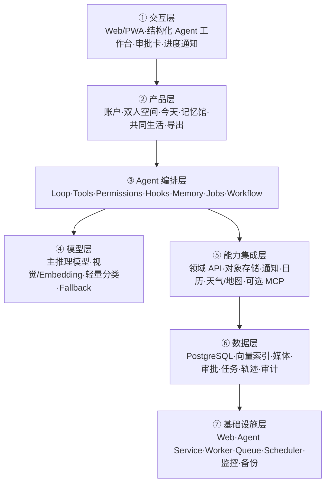

# 双人宇宙：关系记忆与行动 Agent 产品方案（V0.2）

> 文档状态：待确认  
> 上一版本：`couple-universe-product-plan.md`  
> 版本变化：根据 `agent-blueprint` 开发手册与 2026-10-26 竞品研究重构。  
> 核心原则：不是给纪念网站加一个聊天框，而是建立一个有工具、记忆、观察、行动与权限的可信 Agent 产品。

## 0. 本版结论

### 0.1 产品重新定位

“双人宇宙”不再定义为单纯的情侣纪念网站，而是：

> 以双方共同回忆为可信知识底座，帮助两个人记录、整理、计划和制造惊喜，并把相处过程沉淀为永久数字纪念馆的私密关系 Agent。

产品的核心不是“AI 会说浪漫话”，而是它能够：

1. 找到有来源的共同回忆。
2. 将零散素材整理成可编辑的草稿和纪念品。
3. 把愿望变成计划、任务和提醒。
4. 在产生影响前展示动作并取得正确的授权。
5. 验证动作是否真正完成。
6. 让全部共同数据能够导出并长期保存。

### 0.2 产品主循环

```text
记录 → 理解 → 提议 → 确认 → 执行 → 验证 → 沉淀 → 适时唤起
```

这条循环同时连接三个用户价值闭环：

- 记忆闭环：素材进入 → 整理成事件 → 回看 → 制作纪念品。
- 陪伴闭环：每日轻互动 → 双方回应 → 形成新理解 → 沉淀为记忆。
- 行动闭环：愿望 → Agent 规划 → 双方确认 → 完成 → 自动转为回忆。

### 0.3 最重要的产品取舍

- 不做微信替代品，不把即时聊天作为主战场。
- 不靠海量题库建立壁垒，每日互动必须轻、可跳过、可暂停。
- 不做“AI 情感判官”，不诊断关系，不裁决谁对谁错。
- 不让 Agent 暗中写入、发送或删除；共同动作可预览、可审批、可撤销。
- 不把所有会话都当作长期记忆；只保存有来源、值得复用且获得授权的事实。
- 先用单 Agent + 领域技能完成核心闭环，多 Agent 推迟到确有必要时。

## 1. 需求硬事实与待确认项

### 1.1 已确认事实

| 维度 | 当前事实 |
|---|---|
| 产品方向 | 为情侣提供专属数字空间、回忆保存、互动和 AI 助手 |
| 核心素材 | 照片、视频、语音、文字、纪念日与双方共同经历 |
| 核心价值 | 浪漫表达、共同记录、制造惊喜、长期保存 |
| 使用形态 | 手机优先的网站/PWA，并能通过正式公网链接访问 |
| 长期方向 | AI 记忆与工具、外部连接、离线数字博物馆 |
| 隐私前提 | 双方知情，尤其是聊天导入、外部连接与 AI 读取 |

### 1.2 当前合理假设

- 首期先服务一对真实情侣，但底层按多租户、每空间两成员设计。
- 核心数据默认云端私密保存，支持完整导出；不要求首版完全本地运行。
- 首版允许云端模型处理用户明确选中的内容，不默认扫描全部资料。
- 正式生产环境不依赖 Cloudflare Tunnel。

### 1.3 待确认

- 是否必须支持中国大陆稳定访问与备案部署。
- 是否存在双方互相完全不可见的个人私密区。
- 解除关系后共同数据的冻结、导出、保留与删除规则。
- 首版媒体是否同时支持照片、短视频与语音。
- AI 供应商、允许的数据存储地区与单次任务成本上限。
- 完整离线纪念馆是否进入 MVP，还是 MVP 先交付标准 ZIP/Markdown/JSON。

## 2. 竞品结论与机会

详细研究见 `reports/20261026_情侣Agent竞品研究.md`。

### 2.1 竞品能力地图

| 产品 | 已占据的核心位置 | 值得借鉴 | 不应照搬 |
|---|---|---|---|
| Between | 私密双人沟通、相册、纪念日、共享日历 | 私密空间、长期媒体保存、批量下载 | 重做即时通讯与语音通话 |
| Paired | 每日问题、测验、专家关系内容 | 双方回答后揭晓、短时低门槛仪式 | 内容题库军备和课程化负担 |
| Agapé | 每日一个问题的低压力关系仪式 | 一天一次、可持续、双方回答后互看 | 用连续签到制造负罪感 |
| SumOne | 每日问答 + 共同养成角色 | 共同养成、节制频率、轻游戏化 | 广告驱动与复杂虚拟货币 |
| Lovewick | 愿望清单、约会灵感、伴侣备忘、回忆时间线 | 愿望完成后转回忆、惊喜私密项 | 依赖大量人工内容库存 |
| Cupla | 双人日历、任务、愿望与 AI 计划助手 | 自然语言转事件/任务、找共同空闲、隐私粒度 | 首版过度进入家庭效率工具 |
| COUPPLY | 大而全情侣工具箱和 AI 咨询 | 统一搜索、Wiki、旅行计划、AI 数据说明 | AI 裁决争执、功能导航膨胀 |
| My Love | 极简恋爱计时、组件、时间线 | 3 秒内获得价值、首屏倒计时 | 只做计数与主题皮肤 |

### 2.2 竞品研究后必须补充的功能

MVP 新增：

- Agent 指挥台：来源、计划、草稿、审批、进度与交付物卡片。
- 愿望与共同任务：愿望完成后可直接转成回忆。
- 伴侣偏好卡：每条有来源、更新时间、可见范围与确认状态。
- 统一搜索：跨回忆、照片、信件、纪念日、愿望和任务。
- Agent 操作历史与撤销。
- 每日轻仪式：一个问题、一次回忆闪回或一个小行动建议。
- “那年今日”：首版采用确定性规则，AI 只写可选文案。

P1 新增：

- 双方日历接入和共同空闲查询。
- 约会完整闭环：提议→投票→定时→提醒→完成→沉淀回忆。
- 旅行计划板、共享清单和资料 Wiki。
- 图片分组、OCR、语音转写和候选标签确认。
- 官方导出文件导入，不直接抓取微信/QQ。

### 2.3 差异化定位

```text
Between        = 私密沟通与相册
Paired/Agapé   = 关系内容与每日对话
Cupla          = 双人日程和任务效率
COUPPLY        = 大而全的情侣工具箱
双人宇宙       = 可溯源共同记忆 + 可审批行动 Agent + 永久离线数据所有权
```

## 3. 目标用户与核心场景

### 3.1 目标用户

- 重视纪念感、愿意共同记录的情侣。
- 异地、工作繁忙或经常忘记重要日期的情侣。
- 想亲手准备数字礼物，但没有设计和编程能力的人。
- 希望私人资料长期可控、可备份、可离线保存的用户。

### 3.2 Agent 首版只承诺四种高质量任务

1. “帮我找出去年国庆去杭州的回忆，并告诉我来源。”
2. “把这 20 张照片整理成一条回忆草稿，缺失信息标出来。”
3. “结合我们的偏好和预算，给出三个周年纪念方案。”
4. “把今年的回忆整理成纪念册草稿，完成后让我预览。”

### 3.3 典型完整闭环

```text
用户：帮我做今年的周年纪念册
  ↓
系统创建 Agent Run，并展示计划
  ↓
Agent 仅检索用户授权的年份与内容范围
  ↓
固定 Workflow 完成收集、去重、分章与素材缺口检查
  ↓
图片处理进入后台任务，界面显示真实进度
  ↓
Agent 生成带来源的标题和文案草稿
  ↓
用户修改、补充并确认
  ↓
系统生成成品并检查文件、章节和素材覆盖
  ↓
产物进入纪念馆；操作和来源写入审计记录
```

## 4. Agent Harness 五要素

| 要素 | 本产品落地 |
|---|---|
| 工具 Tools | 搜索回忆、读取来源、创建草稿、创建任务、安排提醒、生成纪念册、导出空间 |
| 知识 Knowledge | 业务规则、双方确认的偏好、纪念日、内容模板、隐私规则、工具说明 |
| 观察 Observation | 数据写入结果、素材覆盖率、任务状态、通知状态、文件校验、用户审批与错误 |
| 行动 Action | 数据库/存储 API、后台工作流、通知、日历、天气/地图查询、导出 |
| 权限 Permissions | 个人私密、双方共享、秘密惊喜、外部连接、AI 处理同意、破坏性操作 |

### 4.1 不给 Agent 的能力

- 任意 Shell。
- 任意网络请求。
- 任意数据库 SQL。
- 未经过滤的文件系统读写。
- 未审批的外部消息发送、公开发布、购买或预订。
- 批量永久删除。

Agent 只能调用业务级、参数可校验、权限可判断、结果可验证的原子工具。

## 5. Harness 组件选型

| 蓝图组件 | 阶段 | 是否选择 | 没有它会怎样 | 产品化方式 |
|---|---|---|---|---|
| s01 Agent Loop | MVP | 是 | Agent 无法根据工具结果继续完成任务 | 受最大轮数、时限和成本约束的主循环 |
| s02 工具系统 | MVP | 是 | 只能聊天，无法读取或交付真实结果 | 领域工具注册表与严格 Schema |
| s03 权限系统 | MVP | 是 | 可能越权读取或产生未授权写入 | L0-L4 权限、默认拒绝、审批令牌 |
| s04 Hooks | MVP | 是 | 审计、权限、指标侵入主循环 | 输入、工具前、工具后、停止四类事件 |
| s05 轻量计划 | MVP | 是 | 多步任务状态不透明 | 每次 Run 的短计划与进度卡 |
| s06 子 Agent | P2 | 否 | MVP 四类任务仍可由单 Agent 完成 | 复杂旅行/大型纪念册再启用 |
| s07 技能加载 | MVP | 是 | 领域规则会塞满系统提示词 | 按任务加载纪念册、约会、导出等技能 |
| s08 上下文压缩 | MVP 简化 | 是 | 长任务成本上升并可能超上下文 | 保存来源引用，裁旧工具结果，必要时摘要 |
| s09 记忆系统 | MVP | 是 | 不能跨会话利用偏好和共同事实 | 选择→提取→确认→整合→按需召回 |
| s10 持久任务系统 | P1 | 暂缓 | MVP 仍可依赖 Run/Job；长期计划才需要 DAG | 纪念日准备、旅行和共同目标 |
| s11 后台任务 | MVP | 是 | 媒体与导出会阻塞请求 | 队列 + Worker + 状态通知 |
| s12 定时调度 | P1 | 暂缓 | MVP 可手动创建日期；主动服务需调度 | 纪念日、时间胶囊、每周互动 |
| s13 Agent Teams | P2 | 否 | 首版没有不可控的并行复杂度 | 仅内部复杂任务使用，不做前台噱头 |
| s14 MCP | P1/P2 | 预留 | MVP 内部数据闭环不需要外部生态 | 日历、天气、地图使用白名单适配器 |
| s15 集成 Harness | MVP | 是 | 各机制无法在同一生命周期协调 | 单一编排内核与共享 Run 状态 |
| s16 Workflow Runtime | P1 | 轻量预留 | 固定流程交给模型会不稳定 | 年度纪念册、纪念日策划固化为流程 |
| s17 Goal Loop | P2 | 否 | MVP 由确定性验收器即可判断完成 | 只用于可验证目标，不用于“让对方开心” |

## 6. 产品信息架构

### 6.1 四个一级空间

#### 今天

- 恋爱天数与下一纪念日。
- 今日回忆/那年今日。
- 今日一个轻互动。
- 待确认的 Agent 建议。
- 近期共同任务与时间胶囊。

#### 记忆馆

- 时间线、相册、信件、纪念日和地图。
- 统一搜索与来源筛选。
- 年/月回顾与纪念册。
- 离线导出入口。

#### 共同生活

- 愿望清单。
- 共同任务。
- 约会计划。
- 伴侣偏好卡。
- P1：共享日历、旅行计划与资料 Wiki。

#### Agent

- 自然语言请求入口。
- 当前计划和进度。
- 来源卡、草稿卡、审批卡和交付物卡。
- Agent 操作历史、撤销和错误恢复。
- 当前授权范围与 AI 数据说明。

### 6.2 页面路由建议

```text
/
/login
/onboarding
/invite/:token
/space/:spaceId/today
/space/:spaceId/memories
/space/:spaceId/memories/:memoryId
/space/:spaceId/wishes
/space/:spaceId/tasks
/space/:spaceId/agent
/space/:spaceId/agent/runs/:runId
/space/:spaceId/letters
/space/:spaceId/anniversaries
/space/:spaceId/settings/privacy
/space/:spaceId/settings/consent
/space/:spaceId/settings/export
```

### 6.3 Agent 工作台不是普通聊天框

每次 Agent 回复由结构化区域组成：

1. 结论：它准备或已经完成了什么。
2. 来源：使用了哪些回忆、日期、照片和用户偏好。
3. 计划：当前步骤、已完成、正在进行和阻塞项。
4. 草稿：可直接编辑的方案、信件、回忆或纪念册。
5. 审批：动作对象、影响范围、接收者、执行时间与撤销方式。
6. 结果：工具实际返回状态，不用自然语言假装成功。

## 7. 领域工具设计

### 7.1 MVP 工具

| 工具 | 输入 | 输出 | 副作用 | 权限 |
|---|---|---|---|---|
| `search_memories` | 查询、日期范围、标签、可见范围 | 来源 ID 与摘要列表 | 无 | L0 自动 |
| `get_memory_source` | 来源 ID | 原文/媒体元数据与权限标签 | 无 | L0 自动 |
| `suggest_memory_metadata` | 来源 ID 列表 | 候选日期、地点、标题、标签、置信度 | 无 | L0 自动 |
| `create_memory_draft` | 来源、正文、元数据 | 草稿 ID 与 diff | 创建个人草稿 | L1 可撤销 |
| `create_plan_draft` | 目标、约束、候选方案 | 计划草稿与缺口 | 创建个人/共同候选 | L1 |
| `create_agent_task` | 标题、步骤、截止日期 | 任务 ID | 创建待办 | L1/L2 |
| `generate_album_job` | 时间范围、来源、模板 | Job ID | 启动后台处理 | 范围确认后 |
| `export_space_job` | 导出范围与格式 | Job ID | 打包私密数据 | 二次验证 |

### 7.2 P1 工具

- `get_mutual_availability`
- `create_shared_calendar_draft`
- `schedule_reminder`
- `get_weather`
- `search_places`
- `create_trip_plan`
- `parse_official_export`
- `transcribe_audio`
- `extract_image_text`
- `publish_memory`
- `reveal_surprise`

### 7.3 工具结果统一协议

```json
{
  "ok": true,
  "status": "completed",
  "resource_id": "...",
  "observation": "数据库中的实际状态",
  "undo_token": "...",
  "warnings": [],
  "error": null
}
```

工具失败必须返回结构化错误，不得让模型从异常文本猜测结果。

## 8. 权限、同意与审批

### 8.1 四个数据空间

| 空间 | 谁可见 | Agent 默认权限 |
|---|---|---|
| 我的私密 | 仅创建者 | 仅当前用户明确选择后读取 |
| 双方共享 | 两位成员 | 可按任务范围只读检索 |
| 秘密惊喜 | 创建者，在解锁后转给对方 | 不向另一方的 Agent 上下文泄露 |
| 系统运行 | 审计、任务、审批、轨迹 | 只用于安全与运行，不用于情感推断 |

### 8.2 权限等级

| 等级 | 示例 | 处理 |
|---|---|---|
| L0 只读 | 搜索获授权回忆、计算日期 | 自动执行，显示来源范围 |
| L1 个人可逆 | 创建个人草稿、候选标签 | 可执行，提供撤销 |
| L2 共同空间写入 | 发布共同回忆、修改共同纪念日 | 执行前显示 diff 并确认 |
| L3 外部行动 | 写外部日历、通知、消息 | 显示对象、内容、渠道、时间后确认 |
| L4 高敏感 | 导入聊天、AI 读取全部历史、删除空间、公开发布 | 二次验证；部分必须双方分别同意 |

### 8.3 永久禁止自动执行

- 冒充任一方发言。
- 秘密监控位置、设备、聊天或情绪。
- 推断忠诚度、关系去留、心理疾病或“谁对谁错”。
- 未经选择把全部私密内容发送给模型。
- 绕过一方撤销的同意。
- 永久删除另一方内容。

### 8.4 审批卡必须展示

- 要执行的动作。
- 将读取和写入的数据范围。
- 谁会看到结果。
- 是否调用第三方以及第三方名称。
- 预计耗时与费用等级。
- 是否可撤销、如何撤销。

## 9. 关系记忆模型

### 9.1 记忆分层

| 类型 | 内容 | 规则 |
|---|---|---|
| 原始来源 | 照片、视频、语音、文字、导入文件 | 保留校验值，Agent 不修改原件 |
| 事件记忆 | 约会、旅行、礼物、重要对话 | 关联多个来源，字段可为待确认 |
| 个人偏好 | 饮食、尺码、礼物、禁忌等 | 归属于个人，分享后才进入共同上下文 |
| 共同事实 | 称呼、日期、共同地点、共同愿望 | 记录来源、确认人和更新时间 |
| Agent 推断 | 候选标签、候选地点、摘要 | 独立存储，含置信度和过期时间 |
| 操作记忆 | 计划、任务、审批和运行状态 | 不与情感内容混存 |

### 9.2 记忆写入流程

```text
候选信息
  → 判断是否值得跨会话保存
  → 查重与冲突检测
  → 标记来源、所有者和可见范围
  → 需要时请求确认
  → 写入对应记忆类型
  → 后续可纠正、撤销或过期
```

### 9.3 回答规则

- 回答事实查询时附来源。
- 用户陈述与 Agent 推断分开显示。
- 来源冲突时展示冲突，不自行决定哪一个“更浪漫”。
- 没有来源就明确说不知道，并建议补充。
- 不从沉默、照片表情或单方描述推断敏感关系结论。

## 10. 七层技术架构



### 10.1 一条贯穿各层的数据流

```text
用户请求
→ Web 创建 Agent Run
→ Agent Service 加载当前身份、授权和相关技能
→ 只读工具检索带来源的关系记忆
→ 模型提出计划或草稿
→ 权限 Hook 判断是否需要审批
→ Worker 执行慢任务
→ Observation 校验真实状态
→ Web 展示产物、来源、变更与撤销入口
→ 轨迹与审计入库，筛选后才写长期记忆
```

### 10.2 横切关注点

- 安全边界贯穿登录、数据查询、工具审批、第三方连接和日志脱敏。
- 可观测性贯穿 Agent Run、模型调用、工具调用、后台任务、工作流和通知。

## 11. 技术选型

| 层级 | 推荐 | 理由 |
|---|---|---|
| Web/PWA | Next.js + TypeScript | 产品页面、SSR、PWA 与 BFF 能力成熟 |
| UI | Tailwind CSS + 可访问组件库 + Motion | 设计令牌统一，支持克制动效 |
| Agent 服务 | Python + FastAPI | 可复用手册中的 Harness 思路，便于模型与媒体生态 |
| 数据库 | PostgreSQL + 行级权限 | 关系、权限和审计模型清晰 |
| 向量检索 | pgvector，MVP 可按需启用 | 与结构化过滤结合，避免独立向量库过早复杂化 |
| 媒体 | 私有对象存储 + 签名 URL | 原图不公开，支持缩略图与生命周期策略 |
| 队列 | 托管 Redis/队列或数据库 Job Queue | 媒体、纪念册和导出异步化 |
| Worker | Python Worker | OCR、转写、去重、排版和导出 |
| 模型层 | Provider Adapter | 模型可替换，按任务路由与降级 |
| 部署 | Web 与 Agent/Worker 分开部署 | 独立扩缩容、故障隔离和回滚 |
| 监控 | 错误监控 + 结构化日志 + Agent Trace | 能还原失败，但不记录私密正文 |

本地开发可用 Docker Compose 一条命令启动；生产环境至少划分 Preview 与 Production，密钥只由部署平台管理。

## 12. 核心数据模型

### 12.1 产品域

- `profiles`
- `spaces`
- `space_members`
- `invitations`
- `source_assets`
- `memory_events`
- `memory_event_sources`
- `anniversaries`
- `letters`
- `wishes`
- `shared_tasks`
- `preference_cards`
- `daily_rituals`
- `ritual_answers`
- `generated_artifacts`
- `export_jobs`

### 12.2 Agent 域

- `agent_sessions`
- `agent_runs`
- `agent_run_steps`
- `tool_calls`
- `tool_observations`
- `approval_requests`
- `consent_grants`
- `memory_claims`
- `agent_tasks`
- `background_jobs`
- `scheduled_actions`
- `workflow_runs`
- `audit_logs`

### 12.3 关键字段约束

- 所有共享实体必须含 `space_id`。
- 所有私密实体必须含 `owner_id` 和 `visibility_scope`。
- 所有 Agent 推断必须含 `source_refs`、`confidence`、`status` 和 `expires_at`。
- 所有工具调用必须含 `actor_id`、`run_id`、`risk_level`、`approval_id` 和 `result_status`。
- 媒体表只保存私有对象键，不保存长期公开 URL。

## 13. 系统提示词草案

```text
你是“双人宇宙”的关系记忆与计划助手。

你的职责是帮助用户整理已授权的共同回忆、生成可编辑草稿、
计划纪念活动，并制作可验证的数字纪念品。

规则：
- 只访问当前用户和空间明确授权的数据。
- 个人私密内容不能用于共同回答，除非拥有明确分享授权。
- 将来源事实、用户陈述和模型推断分开。
- 没有来源的关系事实不得编造。
- 默认先生成草稿，不直接发布、发送、删除或对外连接。
- 共同空间写入、外部行动和破坏性操作必须通过对应审批。
- 不进行心理诊断，不替任何一方做关系决定，不冒充伴侣。
- 工具执行后检查实际结果；失败时说明状态并提供恢复入口。

完成时输出：
- 交付物或结果
- 使用的来源
- 执行的变更
- 待确认内容

无法继续时：
- 明确说明缺少的数据、权限或用户选择，不得自行扩大访问范围。
```

## 14. 固定 Workflow 与后台任务

### 14.1 年度纪念册 Workflow

```text
选择年份和权限范围
→ 收集来源
→ 去重与质量检查
→ 事件聚类
→ 章节提纲
→ 文案和版式草稿
→ 素材覆盖检查
→ 用户预览和修改
→ 导出
→ 文件校验与入馆
```

### 14.2 纪念日策划 Workflow

```text
读取日期、预算和已共享偏好
→ 生成候选方案
→ P1 查询天气/地点/共同空闲
→ 预算和限制检查
→ 用户选择
→ 创建任务与提醒草稿
→ 审批后写入
```

### 14.3 后台任务

- 图片压缩、缩略图和感知去重。
- 视频关键帧与封面。
- 语音转写与 OCR。
- 纪念册渲染。
- 离线导出。
- 官方导出文件解析。

状态统一为：

```text
queued → running → waiting_for_approval → completed / failed / cancelled
```

## 15. MVP / P1 / P2 范围

### 15.1 MVP：可信记忆 Agent

产品功能：

- 双人账户、邀请认领、空间权限。
- 今天：首页倒计时、那年今日、精选回忆。
- 记忆馆：时间线、相册、信件、纪念日、统一搜索。
- 共同生活：愿望、共同任务、伴侣偏好卡。
- 每日轻仪式：问题/回忆/小行动三选一，可跳过和暂停。
- Agent 工作台与四种承诺任务。
- 标准 ZIP/JSON/Markdown 导出。
- PWA、弱网草稿、媒体上传恢复。

Harness：

- 单 Agent Loop。
- 8 个以内原子工具。
- 权限管线、Hooks、技能加载、记忆召回。
- 后台任务与结构化进度。
- 所有写入默认先进入草稿。

### 15.2 P1：主动服务与行动闭环

- 持久任务系统与依赖关系。
- 定时提醒、安静时段、时区和幂等。
- 双方日历与共同空闲查询。
- 天气、地图、地点只读连接。
- 约会和旅行完整闭环。
- 月度/年度回顾 Workflow。
- 时间胶囊完整状态机。
- OCR、语音转写、图片自动分组。
- 官方聊天导出文件的授权导入。
- 完整离线静态纪念馆。

### 15.3 P2：高级 Agent 与沉浸空间

- 内部多 Agent：档案员、策划师、研究员、审校员。
- 复杂旅行/周年工作流与可验证 Goal Loop。
- 经授权的外部日历写入、通知和预订跳转。
- 专属互动游戏或 GALGAME。
- 2D/3D 数字博物馆。
- 完全本地 Agent、端侧模型与 U 盘版本。

## 16. 视觉与体验方案

### 16.1 视觉方向

- 主风格：高级克制的夜空、星轨、胶片与暖光，不做模板化粉色。
- 首页唯一焦点：关系天数 + 下一重要日期 + 今日入口。
- 记忆以“星体/胶片卡片”呈现，但内容阅读保持清晰。
- Agent 使用中性可信视觉，避免神秘“全知 AI”形象。
- 秘密惊喜空间与共同空间用明显但不泄密的视觉区分。

### 16.2 关键交互原则

- 首屏 3 秒内给价值，不强迫用户先聊天。
- 惊喜开场首次或主动重播才出现，不能阻挡日常使用。
- 每个 Agent 动作先展示计划；敏感动作展示审批卡。
- 每个 AI 结论都能展开查看来源与不确定项。
- 每个失败状态都有重试、修改范围或改为手动的入口。
- 支持减少动态效果、高对比度、键盘操作和屏幕阅读器。

## 17. 指标体系

### 17.1 产品指标

- 空间激活率：完成第一条回忆并发出邀请。
- 双人激活率：伴侣在 7 天内成功加入并完成一次共同动作。
- 记忆沉淀率：愿望/任务完成后转为回忆的比例。
- 30 日共同空间活跃率。
- 导出完成率与恢复验证通过率。

### 17.2 Agent 指标

- 任务完成率。
- 首次计划被接受率。
- 草稿发布前人工修改率。
- 来源覆盖率与“无来源事实”拦截率。
- 工具成功率、重试率和错误恢复率。
- 权限拦截正确率与误拦截率。
- 每任务模型成本、P50/P95 完成时延。
- 撤销率与敏感动作投诉数。

核心健康指标不是“聊天轮数”，而是：

> 用户是否以可控成本完成了有来源、可确认、可带走的关系交付物。

## 18. 非功能要求

| 项目 | MVP 标准 |
|---|---|
| 性能 | 正常 4G 下首页 LCP ≤ 2.5 秒，媒体不阻塞首屏 |
| Agent 时延 | 只读搜索 P95 ≤ 8 秒；长任务立即返回 Job ID |
| 可用性 | AI 不可用时，记录、时间线、倒计时和导出仍可使用 |
| 权限 | 所有工具服务端二次鉴权；前端隐藏不算权限 |
| 可观测性 | 每个 Run、工具、审批和 Job 有追踪 ID |
| 隐私 | 日志不记录正文、原图 URL、邀请令牌和完整提示词 |
| 可访问性 | 核心流程达到 WCAG 2.2 AA |
| 兼容性 | 最近两个主要版本的 Safari、Chrome、Edge |
| 可恢复性 | 数据库自动备份；导出包抽样恢复通过 |
| 成本 | 每类 Agent 任务设置预算、轮数、超时和降级模型 |

## 19. 开发里程碑

### M0：范围冻结与 UI 原型

- 确认待确认项。
- 完成四个一级空间、Agent 工作台和审批卡高保真设计。
- 用点击原型走通四个 Agent 承诺任务。
- 建立权限矩阵和记忆可见性规范。

退出条件：关键状态、异常状态和审批状态不依赖开发者猜测。

### M1：产品与 Agent 骨架

- 初始化 Web、Agent Service、数据库、对象存储和 CI。
- 完成账户、双人空间、邀请和行级权限。
- 完成 Agent Loop、工具注册、权限 Hook 与 Run 追踪。
- 用假数据跑通“搜索回忆→创建草稿”。

退出条件：第三方账户无法越权；Agent 不能绕过工具访问数据。

### M2：记忆馆与可信检索

- 完成回忆、相册、纪念日、信件、愿望、任务和偏好卡。
- 完成统一搜索、来源引用和候选推断确认。
- 完成媒体上传、缩略图与后台任务。

退出条件：可稳定完成四类 MVP Agent 任务中的前三类。

### M3：纪念册、导出与每日仪式

- 完成纪念册轻量 Workflow。
- 完成每日仪式、那年今日和首页聚合。
- 完成导出、审计、撤销、退出和删除流程。

退出条件：年度纪念册草稿可生成，导出包可离线检查完整性。

### M4：生产硬化与发布

- 权限、安全、性能、可访问性与跨设备测试。
- 模型超时、限流、失败与成本降级。
- 生产部署、域名、监控、备份、恢复与回滚演练。

退出条件：P0 验收全部通过，无阻断和高危缺陷。

## 20. MVP 验收标准

### 20.1 产品验收

- [ ] 用户能在 5 分钟内创建空间、添加第一条回忆并邀请伴侣。
- [ ] 一次性邀请过期、撤销或使用后不能再次加入。
- [ ] 两位成员均可记录，第三方无法猜 ID 读取数据或媒体。
- [ ] 每日仪式可以跳过、暂停和调整频率。
- [ ] 愿望或共同任务完成后可一键转为回忆。
- [ ] 数据可导出为含索引、JSON、Markdown、媒体和校验清单的 ZIP。

### 20.2 Agent 验收

- [ ] 搜索结果附带真实来源 ID，可打开原始回忆。
- [ ] 无来源事实不会被写成共同事实。
- [ ] 创建草稿后展示字段级变更与撤销入口。
- [ ] 发布共同内容必须经过对应审批。
- [ ] 个人私密和秘密惊喜不会泄露给另一方的 Agent 会话。
- [ ] 纪念册后台任务可重试、取消并恢复状态。
- [ ] 工具失败时 Agent 不宣称成功。
- [ ] 每个 Run 可查看计划、工具记录、审批、结果和成本摘要。
- [ ] 模型不可用时核心非 AI 功能不受影响。

### 20.3 生产验收

- [ ] 一条命令启动本地完整环境，配置与密钥外置。
- [ ] CI 包含类型检查、Lint、单测、权限测试和关键 E2E。
- [ ] Preview 与 Production 数据完全隔离。
- [ ] 数据库迁移、部署和回滚可重复执行。
- [ ] 生产日志不含私密正文和长期可用媒体地址。
- [ ] 备份恢复与导出恢复至少各完成一次演练。

## 21. 风险与应对

| 风险 | 应对 |
|---|---|
| 把 Agent 做成无用聊天框 | 用四类可验收任务定义 MVP，界面以产物和行动为中心 |
| 一开始堆满全部蓝图组件 | 每个组件必须回答“没有它 MVP 是否失败” |
| AI 记错双方事实 | 来源引用、推断隔离、确认后升级、允许纠正 |
| 一方内容泄露给另一方 | 四类可见性、服务端策略、越权自动化测试 |
| AI 处理私密数据不透明 | 每次显示数据范围、供应商、保存策略和授权人 |
| 固定流程被模型自由发挥 | 纪念册和策划写成 Workflow，模型只处理需要判断的步骤 |
| 媒体和导出拖垮请求 | Worker、队列、Job 状态、重试和幂等 |
| 每日互动变成关系作业 | 低频、可跳过、可暂停，不使用惩罚性连续签到 |
| 产品变成大而全工具箱 | 四空间结构，MVP 只保证四种 Agent 任务 |
| 分手/退出导致数据纠纷 | 开发前确定共同数据冻结、导出和删除规则 |

## 22. 下一步

确认本方案后按以下顺序执行：

1. 回答六个待确认问题并冻结 V0.3 PRD。
2. 先制作手机端高保真 UI：今天、记忆馆、共同生活、Agent、审批卡和 Run 详情。
3. 完成权限矩阵、数据模型和工具契约评审。
4. 开始 M1 工程骨架；先证明“检索回忆→来源→草稿→审批→写入→验证”的最小闭环。
5. 骨架验收后再进入媒体、纪念册和主动服务，避免边做界面边改变核心架构。
