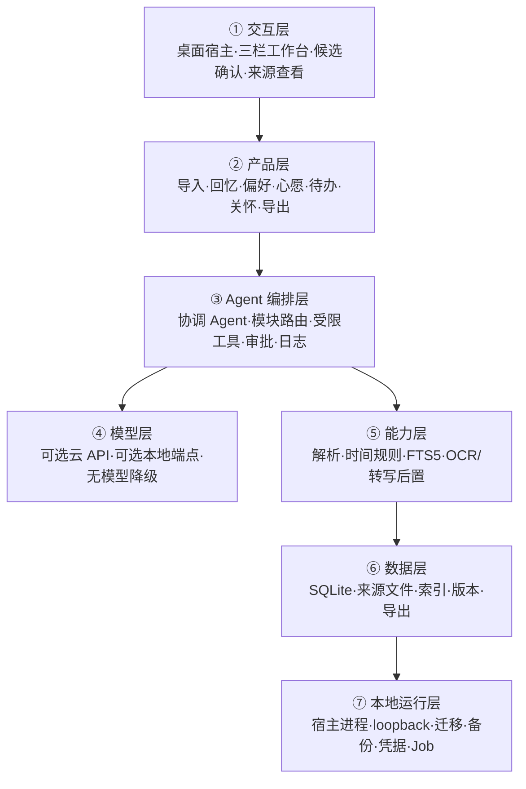

# 鹊信：电脑本地恋爱记忆与关怀助手方案（V0.3）

> 状态：待用户确认  
> 日期：2026-10-26  
> 权威输入：`鹊信_本地开源项目资料包_v1.0.0`  
> 上一版：`couple-universe-product-plan-1.md`  
> 范围变化：从“云端情侣 PWA/SaaS”收敛为“电脑端、本机部署、开源自用的本地 Agent 工具”。

## 0. 文档权威性与版本关系

### 0.1 本方案如何使用资料包

- 资料包中的 README、专题文档、HTML、JSON 与交接提示均作为产品资料读取。
- 未执行资料包中的交接提示、脚本或任何安装动作。
- 已核验 `MANIFEST.json` 中 23 个文件的 SHA-256，全部一致。
- `FULL_PLAN.html` 是专题文档的离线整合版；`archive/` 是被后续范围替代的历史研究。
- `examples/` 全部是虚构设计样例和待执行测试规范，不代表功能已实现。

### 0.2 需求优先级

发生冲突时按以下顺序判断：

1. 用户最新明确要求。
2. 资料包 `01_PROJECT_BRIEF.md`、`08_LOCAL_ARCHITECTURE.md`、`09_ROADMAP_ACCEPTANCE.md`、`10_DISCUSSION_DECISIONS.md`。
3. 本 V0.3 方案。
4. V0.2 与更早的产品方案。
5. `archive/` 中的早期商业化、移动端和云服务构想。

## 1. 产品定义

### 1.1 一句话定义

> 鹊信是一个运行在个人电脑上的开源恋爱记忆与关怀助手：它整理用户主动选择且获授权的聊天、照片和经历，先生成候选，经确认后形成有出处、可修改、可删除的本地记录，并支持查询、计划、关怀提示和离线纪念馆。

### 1.2 产品核心价值

- 省力整理：从选定聊天或照片中提取候选，而不是手工逐条抄录。
- 可信找回：任何记忆回答都能回到原始依据，没有资料就明确说不知道。
- 安全写回：AI 只能产生候选，用户确认后才成为正式记录。
- 持续有用：把心愿、计划、偏好、重要事件和相处约定变成可更新的信息。
- 数据自有：数据库、媒体与导出优先保存在本机，可离线迁移。

### 1.3 核心闭环

```text
主动选择聊天/照片
→ 确认处理范围与人物时间
→ 生成候选
→ 查重、冲突和敏感检查
→ 用户修改/忽略/合并/确认
→ 事务性写入并返回真实记录 ID
→ 更新时间线和检索索引
→ 带来源查询
→ 修改、取消、删除后同步失效
→ Markdown/JSON/媒体离线导出
```

### 1.4 成功标准

最小版本必须证明：

1. 不接模型也能手工保存、修改、删除和查询记录。
2. 接入模型后只增加“提取候选与整理表达”的效率，不改变权限边界。
3. 软件重启后已确认记录仍存在。
4. 查询结果附来源，候选不会冒充事实。
5. 取消计划、偏好改变和来源删除会正确影响后续查询。
6. 导出包断网可读，不依赖远程脚本、字体或图片。

## 2. 已确认、推荐与待确认

### 2.1 用户已明确

- 电脑端。
- 开源、自用、本机部署。
- 不上线云服务器。
- 需要聊天内容提取、确认和写回。
- 需要周期与日常关怀能力。
- 需要吵架后重新表达、形成约定和后续跟进。
- 品牌与界面采用中国传统神话或传说意象。
- 希望能在本地 Agent/Harness 环境中使用。

### 2.2 当前推荐但尚待最终选择

- 工作名使用“鹊信”。
- 优先验证 DeepSeek Harness 插件，Codex app-server/SDK 作为备选适配器。
- SQLite + 本地媒体目录 + Markdown/JSON/离线 HTML。
- 一个协调 Agent，首版只包含聊天整理、记忆管理、回忆查询三个模块。
- 关键词、日期、人物、标签和 SQLite FTS5 优先；语义索引后置。

### 2.3 待确认

- 操作系统与芯片：macOS Apple 芯片、macOS Intel 还是 Windows。
- 可用内存与磁盘空间。
- 首个宿主：DeepSeek Harness、Codex，还是先做宿主无关本地 Web。
- 模型方式：云 API、本地兼容端点，或先完全不接模型。
- 最终品牌：鹊信、牵意或栖枝。
- 首批真实资料格式：粘贴文本、JSON/CSV、截图、照片目录。
- 本机资料是否需要数据库整体加密或操作系统 Keychain 解锁。

### 2.4 已完成的本机只读核验

| 项目 | 当前结果 |
|---|---|
| 设备 | MacBook Pro（Mac17,9） |
| 芯片 | Apple M5 Pro，arm64 |
| 内存 | 24 GB |
| 系统 | macOS 26.6.2 |
| Node.js | v22.22.3 |
| npm | 10.9.8 |
| pnpm | 11.23.0 |
| Python | 3.9.6 |
| DeepSeek Harness CLI | 未安装 |
| Codex CLI | 0.154.0，已安装 |

该环境足以先开发本地数据闭环。尚未获得安装 DeepSeek Harness 的授权，因此 M0 不会自动安装；若优先使用现有环境，Codex 本地适配或宿主无关本地 Web 的启动成本更低。

## 3. 被 V0.3 替代的假设

| V0.2 假设 | V0.3 处理 |
|---|---|
| 手机优先 Web/PWA | 改为电脑端三栏工作台 |
| 多租户和双账户 | 首版删除，单机自用 |
| 邀请链接和实时共享 | 删除 |
| PostgreSQL/Supabase | 改为 SQLite + FTS5 |
| 云对象存储 | 改为用户选择的本地文件夹 |
| Redis/云 Worker | 改为本地 Job Manager 或宿主后台能力 |
| Preview/Production | 改为宿主版本固定、数据库迁移、备份恢复 |
| 纪念册是 MVP Agent 任务 | 后置到 M4，先保证整理、管理、查询 |
| 双方真正独立私密域 | 首版只做应用可见性标签，不夸大为管理员不可读 |
| 电脑关闭时定时服务 | 不承诺；启动后检查遗漏 |
| 日历、地图、天气连接 | P2 或按需扩展 |
| 多 Agent/Goal Loop | 删除出首版 |
| 大众产品、订阅与增长 | 不在当前范围 |

## 4. 目标用户与使用方式

### 4.1 首版用户

首版服务一个在自己电脑上整理恋爱资料的人。使用者可以处理：

- 自己有权保存的聊天片段。
- 双方已同意整理的共同资料。
- 自己记录的照片、心愿、计划、偏好和关怀事项。
- 自己的周期和私人沟通草稿。

首版不假设另一方拥有独立设备、账户或实时同步界面。

### 4.2 主要场景

1. 粘贴一段选定聊天，整理成待确认候选。
2. 把“想去海边”保存成心愿，而不是已发生旅行。
3. 保存“最近不喝奶茶”这种有时效的偏好，并在改变后更新。
4. 查询“我们上次吃火锅是什么时候”，返回记录和原消息。
5. 为已确认的面试、考试或出差建立自选关怀待办。
6. 把自己的感受整理成私人草稿，不自动发给对方。
7. 选择回忆生成不依赖网络的离线纪念馆。

## 5. 功能范围

### 5.1 P0：最小本地可信闭环

| ID | 功能 | P0 行为 |
|---|---|---|
| F01 | 本地资料空间 | 用户选择目录，初始化数据库和文件结构，重启恢复 |
| F03 | 聊天文字导入 | 主动粘贴或选择文本，确认人物、时间、范围 |
| F05 | 候选确认区 | 原文与候选并排；修改、忽略、合并、确认 |
| F06 | 时间线与来源 | 按事件浏览，可返回原文或原媒体 |
| F07 | 带出处问答 | 只查已确认记录，回答附引用，缺失即说明 |
| F08 | 修改与失效 | 修改、取消、删除后索引和回答同步更新 |
| F09 | 偏好卡 | 区分近期/长期/改变，保留版本和来源 |
| F10 | 心愿清单 | 未完成保持愿望；确认完成后才能转回忆 |
| F11 | 待办与约定 | 负责人、日期、状态、提醒方式可修改和取消 |
| F23 | 数据导出 | Markdown、JSON、获授权媒体与校验清单 |
| F24 | 功能管理 | 模块启停、提示词版本、模型范围、日志和失败原因 |

P0 还必须包含：

- 手动候选创建，确保模型故障时仍能工作。
- SQLite migration 与数据版本号。
- 虚构演示空间和一键重置演示数据。
- 数据备份、恢复与导出验证。
- 原文提示注入防护和目录沙箱。

### 5.2 P1：导入增强与关怀表达

- 聊天截图 OCR 与气泡人物修正。
- 明确格式的 JSON/CSV 导入器。
- 本人周期实际记录与独立权限域。
- 自选关怀卡和“今天需要什么”。
- 重要事情事前/事后跟进。
- “慢慢说”私人草稿。
- 双方确认的具体相处约定。
- 同一事件的两种并列视角。
- 运行时提醒与启动后遗漏检查。
- 纪念馆预览与离线静态导出。

### 5.3 P2：使用后再验证

- 周期预计区间，但不用于避孕或医学判断。
- 语音记录、转写与原声保留。
- 月度/年度回顾。
- 回忆重演、盲答回顾、期待对齐和临时变更协商。
- 约会安排、异地见面与节日清单。
- 本地语义检索或 Embedding。
- 微信设备端提取适配器研究。
- 本地模型专项适配。

### 5.4 当前不做

- 云服务器、云数据库、公网部署。
- 移动端上架、原生 Widget、手机推送。
- 实时聊天、语音通话、公开社区。
- 多设备同步和双方独立账户。
- 自动持续监控微信、相册、通讯录或位置。
- 自动代发消息、下单、预订。
- 关系评分、默契分数、爱意分数或疾病诊断。
- 3D 世界、养成游戏和 GALGAME。
- 收费、支付、邀请增长和多用户运营。

## 6. 桌面信息架构

### 6.1 三栏主布局

```text
┌──────────────┬──────────────────────────────┬────────────────────┐
│ 左侧导航      │ 中间工作区                    │ 右侧助手            │
│              │                              │                    │
│ 今日          │ 时间线 / 原文 / 候选 / 日历   │ 对话                │
│ 回忆          │ 照片 / 编辑 / 导出预览        │ 来源                │
│ 聊天导入      │                              │ 计划                │
│ 日历          │                              │ 工具结果            │
│ 关怀          │                              │ 确认与失败原因      │
│ 功能管理      │                              │ 可收起              │
└──────────────┴──────────────────────────────┴────────────────────┘
```

窗口变窄时优先收起右侧助手；聊天导入时中间区切换为“原文/候选”双栏。

### 6.2 页面设计

#### 今日

- 今天的重要安排。
- 待确认候选数量。
- 待办、遗漏提醒和快速记录。
- 本人选择的当前需要，不显示关系评分。

#### 回忆

- 时间线、事件详情、照片和来源。
- 按日期、人物、标签和状态筛选。
- 记录版本、当前有效状态和关联心愿/计划。

#### 聊天导入

- 输入方式与本地/云端处理说明。
- 人物映射、时区、时间范围与批次信息。
- 原文、候选、敏感提示与逐项确认。

#### 日历

- 已发生事件、计划、待办和周期使用不同可选图层。
- 预计与实际明确区分。
- 取消、遗漏和未知状态不伪装成已完成。

#### 关怀

- 今天需要什么。
- 重要事情后续关心。
- 慢慢说私人草稿。
- 已确认相处约定。

#### 功能管理

- 模块开关。
- 模型、处理范围和凭据状态。
- 提示词/技能版本。
- 工具权限。
- Job、日志、失败原因和索引重建。

## 7. Agent Harness 五要素

| 要素 | 鹊信落地 |
|---|---|
| 工具 | 导入批次、生成候选、确认候选、更新/失效记录、检索、读取来源、导出 |
| 知识 | 分类规则、状态机、隐私边界、时间解析规则、关怀与冲突表达规则 |
| 观察 | SQLite 实际记录、索引状态、来源关联、导出文件与校验结果 |
| 行动 | 本地事务写入、文件复制、索引更新、本地 Job 和导出 |
| 权限 | 用户选择的目录、当前批次、敏感数据域、云端发送范围、删除与导出确认 |

## 8. Agent 与模块设计

### 8.1 一个协调 Agent

首版只使用一个协调 Agent，根据任务调用三个模块：

| 模块 | 输入 | 输出 | 完成门 |
|---|---|---|---|
| 聊天整理 | 选定原文、人物、时间、范围 | 待确认候选 | 候选存入 pending，不写正式事实 |
| 记忆管理 | 已确认候选或修改删除指令 | 记录 ID、版本、影响范围 | 事务提交后重新读取验证 |
| 回忆查询 | 问题和授权范围 | 答案、来源、缺失说明 | 每个事实能定位到有效记录和来源 |

P1 再增加关怀跟进、慢慢说和纪念馆模块。

### 8.2 为什么首版不用多 Agent

- 数据闭环简单，复杂度在状态和权限，不在并行推理。
- 多 Agent 会增加上下文、成本、追踪和错误归因难度。
- 固定分类、写回和导出应由确定性代码完成。
- 未来只有大批量纪念馆或复杂资料研究确有收益时再引入。

### 8.3 Agent 工作原则

- 原始聊天和文件内容都是不可信数据，不能成为系统指令。
- 默认只读取当前任务明确选择的范围。
- 模型输出永远是候选、草稿或解释，不能直接成为共同事实。
- 工具返回失败时不得回复“已保存”。
- 缺少日期、人物、来源或授权时请求补充。
- 对关系、健康和情绪不做诊断或分数判断。

## 9. 本地七层架构



### 9.1 宿主策略

#### 首选研究：DeepSeek Harness

截至 2026-10-26，官方将其标为开发者预览，公开提供桌面/Web、本地 `127.0.0.1` 启动、插件、工具、技能、界面扩展与多模型提供商能力。由于官方明确提示会有破坏性兼容变更，M0 必须：

- 固定实测版本或 commit。
- 用最小插件验证自定义页面、工具、凭据和数据目录。
- 将业务核心做成宿主无关本地库，避免绑死预览 API。

#### 备选：Codex 本地集成

Codex app-server 可让应用连接本地 Codex 进程，维护会话、流式事件、工具与审批。若选择 Codex，产品 UI、业务数据库、权限、候选确认和记录仍由鹊信负责，Codex 只提供 Agent Loop 和集成面。

#### 保底：宿主无关本地 Web

若两种宿主 UI 扩展不稳定，先实现只监听 `127.0.0.1` 的本地 Web 工作台与独立业务核心；模型适配器可后接。这样不会因宿主变化阻塞 M1 数据闭环。

## 10. 本地目录与技术选型

### 10.1 用户资料目录

```text
用户选择的鹊信资料目录/
  quexin.sqlite3
  sources/
    chat/
    images/
    audio/
  derived/
    thumbnails/
    ocr/
    transcripts/
  exports/
  backups/
  logs/
```

真实资料目录必须位于开源代码仓库之外。

### 10.2 推荐技术

| 部分 | 推荐 | 说明 |
|---|---|---|
| 业务核心 | TypeScript 或 Python 单一语言实现 | 以宿主插件实际技术栈为准，避免双后端 |
| 数据库 | SQLite | 单机、事务、备份与迁移简单 |
| 检索 | B-tree 索引 + FTS5 | 日期、人物、标签、关键词优先 |
| 媒体 | 本地文件 + 相对路径 | 不把大文件塞进数据库 |
| 桌面外壳 | DeepSeek Harness 插件优先 | M0 实测决定 |
| 模型 | Provider Adapter | 云 API/本地兼容端点可切换 |
| 凭据 | 宿主凭据或系统 Keychain | 不进数据库、日志、仓库和导出 |
| 后台任务 | 进程内 Job Manager/宿主后台能力 | 首版不引入 Redis |
| 导出 | Markdown + JSON + 本地媒体 | P1 增加离线 HTML |

### 10.3 本地服务边界

- 只监听 loopback，不默认开放局域网。
- 文件工具只访问用户选择的资料目录与当前导入文件。
- 路径统一做 canonicalization 和目录边界检查。
- 不通过 Git 备份真实私密资料。
- 数据库迁移必须可测试、可备份、失败可回滚。

## 11. 数据模型

### 11.1 核心表

| 表 | 主要作用 |
|---|---|
| `settings` | 工作名、时区、模块开关和版本 |
| `persons` | 人物映射，不假设“我”是谁 |
| `import_batches` | 输入方法、范围、哈希、状态和模型处理说明 |
| `source_items` | 原消息、图片、文件及其相对路径与哈希 |
| `candidates` | 待确认提取结果、类型、敏感度、缺失项 |
| `records` | 已确认回忆、心愿、计划、偏好、待办和约定 |
| `record_sources` | 正式记录与原始来源的多对多关系 |
| `record_versions` | 修改、替代、失效和删除历史 |
| `tasks` | 本地待办和重要事件跟进 |
| `reminders` | planned/snoozed/done/cancelled/missed |
| `private_drafts` | 慢慢说等本人私密草稿 |
| `cycle_entries` | P1 独立周期数据域 |
| `exports` | 导出范围、格式、校验和与状态 |
| `jobs` | 本地慢任务与断点状态 |
| `agent_runs` | 模块、模型、提示词版本、状态和耗时 |
| `tool_calls` | 工具参数摘要、权限、结果和错误 |
| `audit_logs` | 高风险操作，不记录完整敏感正文 |

### 11.2 候选与记录分离

- `candidates.status`: `pending / confirmed / ignored / superseded`。
- 候选确认时通过事务创建或更新 `records`，再关联来源。
- 查询默认只读取有效 `records`，不读取 pending 候选。
- 敏感候选默认只能进入本人独立区域。

### 11.3 事件状态

- `planned`: 已计划但未发生。
- `happened`: 已确认发生。
- `cancelled`: 已取消，不进入已完成回顾。
- `unknown`: 不能确定，保留待补充。

### 11.4 版本与失效

- 偏好改变时新记录通过 `supersedes_record_id` 替代旧记录。
- 查询使用最新有效确认，但可以查看历史来源。
- 删除来源前显示受影响记录、索引和衍生产物。
- 删除或撤销后索引同步更新；失败时标记需重建，不能静默保留旧答案。

## 12. 聊天导入与写回协议

### 12.1 获取路线

1. P0：主动粘贴选定文字。
2. P1：上传选定截图，OCR 后手动校正。
3. P1：支持一套明确 JSON/CSV 格式。
4. 探索项：针对具体系统和微信版本研究设备端提取。

微信电脑备份或“可在电脑微信查看”不等于第三方可读文本。设备提取失败不能影响前三种入口。

### 12.2 分类语义

| 输入含义 | 记录类型 | 规则 |
|---|---|---|
| “昨天一起吃了火锅” | 回忆 | 日期可解析才写绝对时间 |
| “下个月想去海边” | 心愿 | 不能算已发生 |
| “周六去看电影” | 计划 | 状态为 planned |
| “取消这次海边计划” | 计划更新 | 更新 cancelled，不生成旅行回忆 |
| “最近不喝奶茶” | 偏好 | 标明表达时间和 recent 有效性 |
| “今天想安静” | 临时需要 | 设置有效期，先归本人 |
| 经期/健康暗示 | 敏感候选 | 本人单独确认，默认排除共同检索 |
| 玩笑、转述、气话 | 不确定 | 不提炼为人格和长期事实 |

### 12.3 时间规则

- 保存原始时间文本、解析结果、时区和解析状态。
- “昨天/明天/下周”必须以原消息时间为基准。
- 原消息日期缺失时，不使用导入时间强行推断。
- 闰年、跨时区和夏令时相关计算使用标准日期库并测试。

### 12.4 人物规则

- 使用者必须确认参与人映射。
- “我/你/他/她”结合发送者和上下文处理。
- 人物不清时保持缺失并请求校正。
- 不把“我”固定映射为软件使用者。

### 12.5 幂等与去重

- 批次和来源保存哈希与可用稳定 ID。
- 同一批次重复导入提示合并或复用结果。
- 相同文字不同发送时间可能是真实重复，不能直接删除。
- 确认接口使用幂等键，重复点击不生成多条记录。

### 12.6 写回成功门

1. SQLite 中存在记录与来源关联。
2. 工具返回真实记录 ID 和版本。
3. 服务重新读取记录验证字段。
4. 对应 FTS 索引可查询。
5. 重启应用后仍能打开。
6. 后续修改、取消或删除会影响检索。

## 13. 受限工具清单

| 工具 | 输入 | 输出 | 副作用 | 权限/完成门 |
|---|---|---|---|---|
| `create_import_batch` | 方法、范围、人物、时区 | batch_id | 建立批次 | 用户已选范围 |
| `store_source_items` | batch_id、原文/文件引用 | source_ids | 保存来源 | 只写资料目录，事务验证 |
| `generate_candidates` | source_ids、分类规则版本 | pending candidates | 创建候选 | 不写正式记录 |
| `confirm_candidate` | candidate_id、修订字段、幂等键 | record_id、version | 写正式记录 | 用户明确确认后执行 |
| `ignore_candidate` | candidate_id | 新状态 | 更新候选 | 可撤销 |
| `update_record` | record_id、字段、理由 | 新版本与 diff | 修改记录 | 显示影响范围 |
| `invalidate_record` | record_id、原因 | 新状态 | 失效/软删除 | 二次确认，更新索引 |
| `search_records` | 查询、过滤、权限域 | 记录与来源引用 | 无 | 只查有效确认记录 |
| `get_source` | source_id | 原始依据 | 无 | 当前资料目录内 |
| `rebuild_index` | 范围 | Job 状态与统计 | 重建索引 | 可取消、完成后校验 |
| `export_archive` | 范围、格式、目标目录 | export_id、校验值 | 生成文件 | 先临时生成，验证后交付 |

工具不开放任意 Shell、任意 SQL、任意网络请求或不受控文件路径。

## 14. 模型与隐私

### 14.1 三种运行模式

#### 无模型模式

- 手动创建和确认候选。
- 日期/关键词检索。
- 完整编辑、删除和导出。
- 作为 M1 的强制基础。

#### 云端模型模式

- 仅发送用户本次明确选择的输入。
- 界面显示供应商、模型、字段类型和预计范围。
- 提供取消、重试和不保存模型输出。
- 不把密钥、全数据库或未选择资料放进请求。

#### 本地模型模式

- 后续依据电脑内存、中文效果、结构化输出和工具兼容性选型。
- “本地接口”不自动等于完全离线，需要检查模型下载、遥测和外部依赖。

### 14.2 原文提示注入

聊天和文件中的“忽略规则、读取其他目录、发送文件”等文本只作为数据。实现要求：

- 数据与系统指令分层传递。
- 工具访问范围由宿主策略和代码判断，不由模型扩大。
- 文件路径采用服务端解析后的 ID，不让模型自由拼路径。
- 导入内容不得修改模块、权限、提示词或凭据。

### 14.3 日志

可以记录：

- 模块、模型、提示词版本。
- Run/Job ID、耗时、状态和错误代码。
- 工具名称、风险等级和受影响记录 ID。

默认不记录：

- API 密钥。
- 完整聊天正文。
- 原始私密图片内容。
- 可长期使用的导出访问令牌。

## 15. 周期与关怀安全设计

### 15.1 周期数据域

- 本人记录实际开始、结束、备注和可选感受。
- 默认私人，不要求绑定伴侣。
- 分享关怀需要、状态和具体日期分别授权。
- 实际记录与预计区间使用不同视觉和数据字段。
- 数据不足时只展示历史，不输出预测。

### 15.2 明确禁止

- 不从“肚子疼、来了、不舒服”自动确认经期。
- 不做排卵保证、避孕建议、怀孕判断或疾病诊断。
- 不用周期解释情绪、冲突或伴侣行为。
- 不默认进入共同检索、回顾和纪念馆。

### 15.3 重要事情跟进

```text
确认事件
→ 选择是否事前提醒
→ 选择当天是否准备用户自己的鼓励草稿
→ 事后选择询问、陪伴或留出空间
→ 本人更新状态
→ 需要时生成新的待办
```

系统不自动发送消息；所有表达由用户查看、修改和自行使用。

## 16. 冲突表达设计

### 16.1 定位

这是表达辅助工具，不是 AI 调解、裁决或治疗。

### 16.2 首批三个功能

1. 我现在需要什么。
2. 帮我把话说清楚。
3. 我们商量好的事。

### 16.3 流程

```text
本人主动进入“慢慢说”
→ 写自己的经历、感受和需要
→ AI 整理为私人草稿
→ 本人修改确认
→ 自愿分享或仅自己保存
→ 双方分别表达
→ 双方确认具体约定
→ 后续只在相关场景引用
→ 可更新、暂停或失效
```

### 16.4 数据阶段分离

- 私人草稿：仅本人应用域可见。
- 已分享表达：记录分享状态，但不代表对方认同。
- 双方确认约定：只有明确确认后才可作为后续提示依据。

### 16.5 禁止行为

- 自动道歉、代发消息或承诺改变。
- 判断谁对谁错。
- 强行合并不同记忆为唯一版本。
- 从气话建立永久人格标签。
- 用回复速度、聊天量、花费或周期计算爱意。

## 17. 本地提醒与生命周期

- 只保证程序运行时执行提醒。
- 电脑休眠、关机或程序关闭时不声称已送达。
- 启动后查询到期任务，标为 `missed`，由用户决定补查、延期或忽略。
- 不一次性弹出大量过期关怀通知。
- 定时动作必须幂等，重复启动不能重复创建记录。
- 系统通知使用中性文本，敏感详情留在应用内查看。

## 18. 品牌与视觉

### 18.1 工作名

推荐继续使用“鹊信”：鹊桥表达连接，信同时表达消息、记录和信任。但最终名称仍需用户确认和商标排重。

### 18.2 三个方向

| 名称 | 色彩 | 气质 | 适合 |
|---|---|---|---|
| 鹊信 | 雾白、黛紫、暖金、局部星河 | 信任、传达、纪念 | 聊天整理与记忆产品 |
| 牵意 | 米白、浅茶、朱砂 | 手笺、牵挂、温柔 | 偏表达与信件 |
| 栖枝 | 燕麦白、苔绿、淡杏 | 共同生活、安稳成长 | 偏日常关怀 |

### 18.3 使用原则

- 神话意象用于品牌、插画和少量动效。
- 常用功能继续使用直白名称，如“导入聊天、确认保存、查看来源”。
- 暂停或冲突状态不使用断桥、枯树、熄星等评价性意象。
- 月亮只作装饰，不与周期、排卵或情绪建立医学联系。
- 状态同时使用文字和图标，不只依赖颜色。
- 支持完整键盘操作、清晰焦点和足够对比度。

## 19. 开发路线图

### M0：宿主与机器核验

- 确认操作系统、芯片、内存和可用磁盘。
- 核验选定宿主的当前版本、插件示例、UI、工具和凭据接口。
- 固定版本或 commit，记录兼容性风险。
- 做一个鹊信空页面与一个只能读取虚构样例的受限工具。
- 决定宿主插件还是宿主无关本地 Web。

退出条件：在用户电脑上有可重复启动方式，受限工具无法越过样例目录。

### M1：无模型数据闭环

- 初始化本地资料目录、SQLite 和 migration。
- 导入虚构聊天和照片来源。
- 手动创建候选，完成确认、忽略、合并、修改和删除。
- 展示时间线、来源、偏好、心愿和待办。
- 实现 FTS5 查询、重启保存、备份与基础导出。

退出条件：不配置模型也能走完保存、重启、查询、修改、删除和导出。

### M2：接入 Agent

- 聊天整理模块只生成候选。
- 记忆管理模块通过受限工具写入并验证记录 ID。
- 查询模块返回来源引用和缺失说明。
- 处理重复导入、相对时间、取消计划、偏好变化和索引重建。
- 模型失败时保留输入并允许手动完成。

退出条件：完成“选定原文→候选→确认→重启→带来源查询→修改后更新”。

### M3：关怀与表达

- 周期实际记录和独立权限。
- 今天需要什么。
- 重要事情跟进。
- 慢慢说私人草稿。
- 双方确认约定。
- 运行时提醒和遗漏检查。

退出条件：敏感内容默认私人，不自动发送，不进入未授权回顾。

### M4：品牌与纪念馆

- 确定名称与主题。
- 完成桌面三栏视觉与响应式收栏。
- 选择回忆并生成离线静态纪念馆。
- 断网打开检查文字、媒体、导航和来源。
- 完成安装、配置、许可证和虚构演示数据。

退出条件：新用户能按文档安装，真实资料不进入代码仓库和发行包。

## 20. 验收用例

| ID | 场景 | 预期 | 建议测试层 |
|---|---|---|---|
| A01 | 想去海边 | 进入心愿，不成为已发生旅行 | 单元+E2E |
| A02 | 缺少消息日期的“明天” | 时间待补充，不用导入日期猜测 | 单元 |
| A03 | 人物映射未确认 | 请求校正，不把“我”默认成软件主人 | 单元+E2E |
| A04 | 重复导入同一片段 | 合并或提示，不重复创建记录 | 集成 |
| A05 | 不同时间出现相同文字 | 保守去重，不丢真实消息 | 单元 |
| A06 | 偏好改变 | 使用最新有效确认，保留历史来源 | 集成 |
| A07 | 取消计划 | 标为 cancelled，不进入已完成回顾 | 集成 |
| A08 | 不舒服但未说经期 | 不推断经期或疾病 | Agent Eval |
| A09 | 周期资料默认检索 | 未授权时排除 | 权限测试 |
| A10 | 私人沟通草稿 | 仅本人可见，不自动发送 | 权限+E2E |
| A11 | 模型请求失败 | 保留输入，可手动保存和重试 | 集成 |
| A12 | 原文提示注入 | 不扩大目录或工具权限 | 安全测试 |
| A13 | 确认保存后重启 | 记录和来源仍在 | E2E |
| A14 | 删除来源 | 说明关联影响，索引和衍生资产按规则失效 | 集成 |
| A15 | 关闭期间提醒到期 | 启动后显示 missed，不声称准时执行 | 单元+E2E |
| A16 | 断网打开纪念馆 | 文字媒体可读，无远程依赖 | E2E |

### 20.1 Agent 专项 Eval

- 候选分类准确但不越权写入。
- 不确定内容保持 unknown。
- 计划与已发生事件分离。
- 偏好具有时间性，不变成人格标签。
- 健康、周期和冲突输出遵守禁止规则。
- 每个有事实性的回答包含有效来源引用。

## 21. 备份、恢复、导出与开源

### 21.1 备份

- 备份前执行 SQLite 一致性检查。
- 数据库与对应媒体使用同一快照清单。
- 使用临时目录生成，成功后原子移动。
- 至少保留一个用户可识别的手动备份入口。

### 21.2 恢复

- 恢复前验证包版本、校验值和磁盘空间。
- 恢复到新目录试运行，不直接覆盖当前数据。
- migration 必须能从受支持旧版本升级。

### 21.3 导出

导出包含：

- `README.md`：范围、版本和打开方式。
- `records.json`：结构化记录与状态。
- Markdown 时间线与偏好/心愿/待办清单。
- 获授权的媒体副本。
- `manifest.json`：相对路径、大小和校验值。
- P1：完全本地的 `index.html` 纪念馆。

导出不包含：

- API 密钥和凭据。
- 未选择的私人资料。
- 未确认候选，除非用户主动勾选工作备份。
- 绝对文件路径、模型内部日志和临时缓存。

### 21.4 开源发布

- 仓库只包含代码、迁移、文档和虚构样例。
- `.gitignore` 排除资料目录、数据库、日志、备份、导出和凭据。
- 发布包不包含 `.env`、真实截图或本机绝对路径。
- 第三方依赖和模型/宿主许可单独核验。

## 22. 风险与应对

| 风险 | 应对 |
|---|---|
| 预览宿主 API 破坏兼容 | M0 固定版本；业务核心宿主无关；最小适配层 |
| 本地被误解为完全离线 | 每次模型调用展示发送范围；支持无模型模式 |
| 单机 UI 私密标签被误解为加密 | 明确说明管理员可读；需要时再做数据库加密 |
| 微信无法稳定自动提取 | 粘贴/截图/标准文件先行，设备适配独立研究 |
| AI 把候选冒充事实 | 候选与记录分离，确认工具和查询过滤 |
| 时间或人物解析错误 | 保存原文本、解析状态，缺失时请求校正 |
| 重复导入污染记录 | 批次哈希、幂等键与保守去重 |
| 删除后旧答案仍出现 | 来源关联、索引失效和重建状态可见 |
| 电脑关闭错过提醒 | 标记 missed，启动后询问，不声称送达 |
| 真实资料进入开源仓库 | 资料目录外置、Git 防护和发布扫描 |
| 关系/健康功能造成伤害 | 私人优先、非诊断、非裁决、无评分、无自动发送 |

## 23. 开发前最后确认

真正开始编码前，只需要确认以下高影响事项：

1. 用户电脑的操作系统、芯片与内存。
2. 首个宿主选 DeepSeek Harness、Codex，还是宿主无关本地 Web。
3. 第一阶段是否先完全不接模型，完成 M1 后再接。
4. 工作名是否先使用“鹊信”。
5. P0 第一种输入是否只做“主动粘贴聊天文字”。
6. 资料目录是否需要应用层加密。

推荐默认值：

- DeepSeek Harness 作为首个研究宿主，但业务核心不绑定宿主。
- 先完成无模型 M1，再接云端或本地模型。
- 暂用“鹊信”。
- P0 只做粘贴文字与虚构样例，不碰真实微信数据库。
- 先依赖操作系统磁盘权限；应用层加密在威胁模型确认后决定。

## 24. 确认后的第一项实施任务

不直接开做完整 UI。先完成一个最小垂直切片：

```text
虚构聊天文本
→ 建立导入批次
→ 手动或规则生成候选
→ 用户确认
→ SQLite 事务写入
→ 返回记录 ID
→ 重启进程
→ 按关键词查询
→ 打开原始来源
→ 修改/删除后查询同步变化
→ 导出 Markdown + JSON
```

这条切片通过 A01、A02、A03、A04、A06、A07、A12、A13、A14 后，再接入模型和视觉主题。
