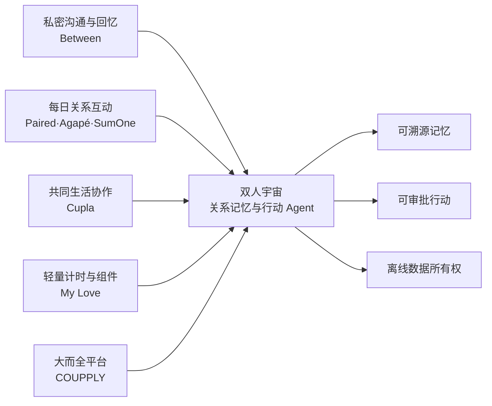

# 情侣数字空间与关系 Agent 竞品研究报告

## 0. 研报前置区

### 0.1 报告摘要

情侣应用已经形成四条较成熟的产品路线：私密沟通与回忆保存、每日关系互动、共同生活协作、轻量计时与组件。Between、Paired/Agapé、Cupla、My Love 分别占据了这些位置，COUPPLY 则在尝试将多种能力整合为一体。

“双人宇宙”不适合重新制造一套聊天软件，也不应依赖海量题库或把所有情侣工具一次堆齐。更有辨识度的方向是：把共同回忆变成有来源的关系知识，让 Agent 在明确权限内完成检索、整理、计划和纪念品制作，并提供完整离线导出。

本报告的核心建议是补充三条产品闭环：每日轻仪式、愿望到行动、行动到回忆；同时把 Agent 的来源、计划、审批、执行结果和撤销做成一等产品界面。

### 0.2 关键结论

| 结论 | 原因 | 证据指向 |
|---|---|---|
| 不能只做照片墙和倒计时 | Between、My Love 已覆盖私密相册、时间线、纪念日与组件 | 官方产品页 |
| 每日轻互动是持续使用的重要入口 | Paired、Agapé、SumOne 都以每日问题建立双人仪式 | 官方帮助与官网 |
| Agent 必须能把语言变成结构化行动 | Cupla AI 已能把脑暴转为事件、任务和约会计划 | Cupla 官方帮助 |
| 隐私差异化不能只写“加密” | COUPPLY 明确说明 E2EE 内容使用 AI 时会在设备解密后发送给 AI 服务 | COUPPLY 隐私政策 |
| 最值得占据的是可信关系记忆 Agent | 竞品各自强在沟通、内容或效率，完整覆盖“来源+审批+行动+离线所有权”的组合仍不突出 | 本报告综合推断 |

### 0.3 核心指标总览

| 指标 | 行业读数 | 目标公司/产品读数 | 判断 | 证据/来源 |
|---|---|---|---|---|
| 市场规模 | 未获得同口径公开数据 | 尚未进入市场 | 不以虚构 TAM 驱动范围 | `gap-retention` 及公开来源缺口 |
| 增速/渗透率 | 未获得同口径公开数据 | 尚未验证 | 先验证双人激活和留存 | 官方页面与后续灰度数据 |
| 竞争强度 | 多条路线均已有成熟产品 | 仍处方案阶段 | 不应同质化堆功能 | 各竞品官网 |
| 盈利水平 | 多数采用免费核心加订阅/内购，缺少可比利润数据 | 尚无商业数据 | 先测媒体与模型单位成本 | 官方产品与帮助页 |
| 景气度 | Cupla/COUPPLY 已出现 AI 助手 | 可从可信记忆与审批切入 | 需做真正工具闭环 | Cupla、COUPPLY |
| 关键风险 | 隐私、双方授权、功能膨胀、内容疲劳 | 风险很高 | 必须产品化治理 | 官方隐私页与功能结构 |

### 0.4 图表清单或图表占位

| 图表 | 类型 | 用途 |
|---|---|---|
| 图表 1: 行业地图与目标位置 | Mermaid | 展示四条主要竞争路线及双人宇宙拟进入的位置 |
| 图表 2: 核心指标总览 | 表格 | 区分已有公开证据、目标当前状态与仍需验证的数据缺口 |
| 图表 3: 七模块判断矩阵 | 分章节分析 | 从可行性、规模性、防守性、盈利性、估值、外部因素和景气度检查项目 |
| 图表 4: 竞争对手对比 | 表格 | 对比主要产品在记忆、互动、共同生活、AI 与隐私上的差异 |

这些图表用于支持产品范围决策，而不是证明市场规模。当前缺少统一口径的商业与留存数据，因此本报告不绘制虚假的市场规模曲线，也不把应用下载量直接当作付费需求。

## 1. 目标公司/产品综合判断

“双人宇宙”适合定位为“关系记忆与行动 Agent”，而不是情侣聊天软件或数字相册。其目标位置位于共同记忆、共同生活与 Agent 执行三者交叉处。

核心优势应来自四个组合能力：可溯源的共同记忆、双主体权限、受审批约束的行动能力、永久可导出的离线资产。核心风险是首版同时做相册、问答、日历、AI、游戏与 3D，导致主线失焦并扩大隐私面。

## 2. 研究边界

| 项目 | 内容 |
|---|---|
| 地区 | 全球可公开访问的英语/国际产品，兼顾亚洲代表产品 |
| 时间范围 | 截至 2026-10-26 的公开产品信息 |
| 行业口径 | 已建立关系后的情侣数字产品，不包含相亲与约会匹配平台 |
| 产品范围 | 私密情侣空间、关系互动、共同生活协作、关系 AI |
| 包括 | Between、Paired、Agapé、SumOne、Lovewick、Cupla、COUPPLY、My Love |
| 不包括 | 公开社交平台、专业心理治疗、纯婚恋撮合、通用日历/网盘 |
| 关键假设 | 官方功能页能代表当前公开能力；未登录实际 App 的隐藏功能不作确定判断 |

### 2.1 研究计划摘要

| 项目 | 内容 |
|---|---|
| 母问题 | 双人宇宙应补充哪些功能，并如何避免同质化 |
| 子问题 | 市场有哪些路线；核心留存机制是什么；AI 已做到哪一步；隐私如何说明；哪些能力应进入 MVP |
| 选择的分析层级 | 宏观、行业、产品微观；不涉及资本市场 |
| 必须验证的事项 | 各竞品核心功能、AI 行动能力、私密数据处理、导出/长期保存能力 |
| 条件模块 | multi_business_split=disabled; portfolio_analysis=disabled; capital_market=disabled |

### 2.2 来源矩阵和证据质量

| 关键 Claim | 来源类型 | 本报告用途 | 证据层级 | 证据质量 | 来源状态 | 独立验证状态 | 限制和缺口处理 |
|---|---|---|---|---|---|---|---|
| `claim-private-space`: Between 覆盖私密沟通、相册、纪念日和共享日历 | 官方官网/帮助中心 | 判断私密空间路线成熟度 | primary | high | obtained | single-source-primary | 未实测客户端；以官方公开能力为准 |
| `claim-daily-ritual`: Paired、Agapé、SumOne 均使用每日双人问题 | 多个官方官网/帮助页 | 判断每日仪式是主流留存机制 | primary | high | obtained | independently_verified | 不推断真实长期留存率 |
| `claim-action-ai`: Cupla AI 可把自然语言转成事件、任务和计划 | 官方帮助中心 | 判断行动型情侣 Agent 已出现 | primary | high | obtained | single-source-primary | 当前存在平台差异，不能外推到全部设备 |
| `claim-ai-privacy`: COUPPLY AI 会接收设备解密后的数据 | 官方隐私政策 | 识别 AI 授权与透明度要求 | primary | high | obtained | single-source-primary | 仅代表该产品公开说明 |
| `claim-export`: Between Plus 支持按日期批量下载照片、视频和笔记 | 官方帮助中心 | 判断数据带走需求已被产品化 | primary | high | obtained | single-source-primary | 不等同于完整结构化离线纪念馆 |
| `claim-opportunity`: 来源、审批、行动与离线所有权的组合是差异化机会 | 综合分析 | 形成目标定位 | near-primary | medium | obtained | independently_verified | 属于推断，需原型与用户访谈验证 |

### 2.3 检索缺口闭环结果

检索先尝试一手或近一手来源，包括产品官网、官方帮助中心、官方隐私政策与应用商店开发者页面；本次对象不是上市公司，因此不存在适用的公司公告、财报、IR 或交易所强制披露。监管和行业协会也没有提供该细分市场的统一留存口径。随后才使用跨产品官方页面做独立验证。下表保留的是经过多轮官方来源检索仍未解决、且会影响结论置信度的问题。

| 缺口 | 已尝试轮次和来源 | 当前状态 | 为什么仍重要 | 未补齐原因 | 下一步来源 |
|---|---|---|---|---|---|
| `gap-retention`: 各竞品可比的 30/90 日双人留存 | 第1轮官网；第2轮帮助中心；第3轮应用商店与公开研究线索 | not-found | 决定轻仪式和工具型功能的真实留存贡献 | 大多数公司未公开同口径 cohort 数据 | 上线后用户访谈、可比产品实测、目标产品灰度数据 |
| `gap-china`: 中国大陆情侣 App 的同口径功能与合规格局 | 第1轮国际产品；第2轮亚洲产品官网；第3轮公开搜索 | definition-mismatch | 若在大陆产品化会影响登录、推送、支付与部署 | 当前研究边界优先验证全球代表产品 | 单独开展大陆市场与合规研究 |

## 3. 宏观环境分析

| 宏观变量 | 当前判断 | 证据/来源 | 对行业和目标的影响 |
|---|---|---|---|
| 隐私与数据权利 | 私密关系数据要求明确访问、删除、携带和第三方处理说明 | Cupla、COUPPLY 等隐私政策 | 权限、同意和导出必须进入 P0 |
| 消费与订阅 | 多数产品采用免费核心 + 情侣共享订阅或内购 | 官方产品/帮助页 | 免费核心必须产生独立价值，避免双人重复付费 |
| 技术周期 | 生成式 AI 从内容建议进入日程、任务和计划执行 | Cupla AI、COUPPLY | 仅聊天已不足，需工具和审批 Harness |

隐私环境对本产品不是“法务上线前再补”的外围问题。情侣空间可能包含身份、位置、行程、私密照片、健康信息和关系状态；当 Agent 同时读取双方数据时，普通单用户应用的授权模型不再充分。产品需要区分内容所有者、空间成员、当前操作者和外部模型供应商，且应在每次高敏感动作前显示实际数据范围。

消费环境意味着用户很容易用微信、系统相册、共享日历和通用 AI 拼出一个低成本替代方案。新产品要收费，不能只提供另一套录入界面；它必须显著降低整理成本，或者交付独特的纪念册、时间胶囊和离线纪念馆等成品。情侣共享订阅比双方分别订阅更符合邀请关系，也能减少“对方不愿付费导致空间失效”的摩擦。

技术周期带来机会也带来依赖。视觉模型、Embedding 与大语言模型降低了照片整理、检索和文案生成成本，但模型价格、上下文长度、地区可用性与数据政策可能变化。因此架构应采用 Provider Adapter，并允许用户关闭 AI 后继续使用记录、浏览、倒计时和导出等核心能力。

## 4. 中观行业分析

### 4.1 行业一句话定义

本报告所称情侣数字产品，是指服务于已建立关系的两位用户，围绕私密沟通、共同记忆、关系互动和共同生活协作提供数字化工具的产品集合。

### 4.2 行业关键指标

| 指标 | 当前判断 | 证据/来源 | 对目标产品的含义 |
|---|---|---|---|
| 使用频率 | 从每日问题到低频纪念册，跨度很大 | Paired/Agapé 与 Between/Cupla 产品结构 | 需同时有日常入口和长期产物 |
| 切换成本 | 记忆、照片和双方绑定提高迁移成本 | Between、My Love、SumOne | 数据带走应成为信任承诺，而非锁定手段 |
| 内容成本 | 问题、课程、建议库需要持续生产与审核 | Paired、Couply、Lovewick | 不应把海量内容当唯一壁垒 |
| AI 成本与风险 | 需要读取高敏感关系数据 | Cupla、COUPPLY 隐私说明 | 最小范围调用、供应商透明、默认草稿 |

### 4.3 行业地图

| 模块 | 内容 | 对目标产品的含义 |
|---|---|---|
| 横向竞争结构 | 沟通、内容、效率、计时四条路线均有成熟玩家 | 目标必须采用组合差异化 |
| 关键生产要素 | 私密数据、内容质量、模型、通知/日历连接、双人网络效应 | 权限和可信度比模型参数更重要 |
| 替代品 | 微信、共享相册、日历、备忘录、通用 AI | 必须减少跨工具搬运并产出不可替代的纪念资产 |
| 目标位置 | 记忆底座连接互动和行动 | 用“完成后沉淀回忆”形成闭环 |

### 4.4 生命周期判断

**阶段结论:** 情侣 App 整体处于成熟细分市场中的 AI 再设计阶段。

**证据:** 私密空间、每日问答、纪念日、日历等基础能力已被多个产品重复验证；Cupla 和 COUPPLY 已开始把生成式 AI 接入计划与关系辅助。

**反证:** 缺乏公开、统一口径的规模和长期留存数据，不能证明所有细分都已商业成熟。

**置信度:** 中。功能格局证据充分，市场规模和商业质量证据不足。

**研究含义:** 双人宇宙不应靠复刻基础功能进入，而应以可信 Agent、数据所有权和产物闭环切入。

## 5. 七个核心模块分析

### 5.1 可行性

**结论:** 产品需求具有可行性，但首版必须聚焦少数可验收的 Agent 任务。

**证据:** 多个现有产品持续提供双人连接、回忆、问题和日历能力；Cupla 已把自然语言转计划和任务做成公开功能。

**机制:** 双人关系具有持续发生的事件、日期和偏好，天然适合结构化记忆与有限自动化；过度开放的情感聊天反而难以验证价值。

**研究含义:** MVP 应承诺搜索回忆、整理草稿、生成纪念方案和纪念册，而不是“什么都能聊”。

**关键指标和后续验证:** 四类任务完成率、草稿采用率、来源覆盖率；通过 3-5 对情侣原型测试验证。

可行性的关键并不在于模型能否写出浪漫文案，而在于用户是否愿意把真实资料放进系统，并认为整理后的产物比自己使用相册和备忘录更省力。验证时应让用户使用真实但可脱敏的 20-50 张照片和几条事件，而不是只评价空白原型。还要分别测试创建者与被邀请者，因为两者对隐私、录入成本和产品价值的感知可能完全不同。若被邀请者不愿加入，单方礼物模式应成为明确的降级形态。

### 5.2 规模性

**结论:** 面向所有情侣具有理论规模，但首期应按私人产品验证，不应提前承担大众 SaaS 的完整成本。

**证据:** 国际竞品覆盖多种情侣阶段与异地场景；但公开可比用户规模、付费率和留存不足。

**机制:** 产品价值需要双方共同参与，邀请转化和双人激活会成为天然漏斗限制。

**研究含义:** 架构按多租户设计，运营上先服务少量真实情侣并验证双人激活。

**关键指标和后续验证:** 邀请成功率、双人激活率、空间 30 日活跃率；需要真实灰度数据。

规模扩张还受媒体成本和双边网络效应约束。每个新空间需要两位成员共同完成关键动作，不能简单把注册人数视为有效用户；应把“已创建空间、邀请成功、双方完成首次动作”作为三级漏斗。国际竞品说明需求跨地区存在，但登录、推送、支付、地图和模型服务具有区域差异。首版应该先形成可复用的多租户数据模型，不提前建设复杂国际化运营体系。

### 5.3 防守性

**结论:** 单一功能防守性弱，长期防守性来自经用户确认的关系知识图谱、历史产物和可信权限记录。

**证据:** 相册、问答、倒计时、愿望和日历均可被通用工具或竞品替代。

**机制:** 数据量本身不是壁垒；带来源、可纠正、可迁移的共同记忆加上工作流习惯，才形成高价值积累。

**研究含义:** 必须优先建设来源、记忆声明、审批、导出与恢复，而非只优化 UI 皮肤。

**关键指标和后续验证:** 已确认记忆数量、跨模块复用率、导出成功率、用户信任访谈。

可信记忆的防守性取决于数据质量而非数据封闭。系统应记录每条共同事实的来源、确认人、更新时间和可见范围；用户纠正后，Agent 需要在后续任务中使用最新结论。愿望、任务、日期和完成后的回忆形成结构化关联，才会让产品逐渐理解两个人的共同生活。完整导出会降低锁定，却能提高用户存入高价值内容的信心，这是一种以信任换取深度使用的防守策略。

### 5.4 盈利性

**结论:** 适合情侣共享订阅或一次性纪念品付费，但首版应先控制模型和媒体成本。

**证据:** 多个产品采用免费核心与 Premium；Between Plus 明确一方购买双方使用。

**机制:** 双人分别付费会放大邀请阻力；纪念册、离线馆和高级媒体处理具有更清晰的付费理由。

**研究含义:** 未来可采用“每个双人空间订阅 + 高成本纪念品按次付费”，不在 MVP 先做复杂付费。

**关键指标和后续验证:** 每空间存储成本、每任务模型成本、导出/纪念册意愿；上线后测算单位经济。

成本端需要把静态数据、媒体处理和模型调用拆开核算。普通浏览和倒计时不应产生模型费用；“那年今日”可以先用确定性查询；只有整理、策划和生成任务调用模型。高清长视频、语音转写与大批量纪念册应使用额度或按次付费，避免少量重度用户吞噬全部毛利。商业化测试顺序应是免费核心价值、空间级会员、按次纪念品，而不是上线即设计多档复杂套餐。

### 5.5 估值

**结论:** 当前没有足够公开财务数据对项目估值，应用市场同类数量不能直接转换为商业价值。

**证据:** 本研究重点来源是功能和隐私说明，未获得统一财务披露。

**机制:** 早期价值取决于双人激活、留存、付费与数据治理质量，而非功能数量。

**研究含义:** 在验证留存前不使用宏大 TAM 叙事驱动开发范围。

**关键指标和后续验证:** 双人激活、90 日留存、每空间毛利；未来通过真实运营数据验证。

项目内部资源评估可以使用阶段门而不是货币估值：若原型无法获得较高的伴侣加入率，就不应进入复杂 Agent 和媒体开发；若用户只在周年使用，则应转向高客单纪念品而非日常订阅；若日常仪式有效但 Agent 使用低，则应保留手动空间并把 AI 降为可选工具。只有在行为数据形成后，才适合估算获客成本、生命周期价值和可扩展市场。

### 5.6 外部因素

**结论:** 隐私、模型供应商政策、对象存储成本和 App/PWA 平台能力是主要外部约束。

**证据:** Cupla 和 COUPPLY 的隐私政策均涉及服务商与 AI 处理；部分能力存在 iOS/Android/桌面差异。

**机制:** 双人数据比普通效率工具更敏感，任何模型或平台变更都可能影响用户信任和能力一致性。

**研究含义:** 建立模型适配层、功能降级、数据处理说明和平台能力矩阵。

**关键指标和后续验证:** 模型政策、数据驻留、推送可达率、浏览器兼容；发布前逐项验证。

平台差异会直接影响体验：PWA 可以覆盖主要浏览和记录，但系统级桌面组件、持续后台任务、精细推送与某些日历权限在 iOS、Android 和桌面浏览器上并不一致。首版应把“网页可完成核心闭环”作为底线，把原生 Widget 和深度系统集成列入后续。若面向中国大陆，还需单独验证域名备案、对象存储、短信/登录、推送和模型供应商的稳定性，不能直接沿用国际托管组合。

### 5.7 景气度

**结论:** 生成式 AI 正给成熟情侣工具带来新的产品窗口，但新鲜感不能代替留存价值。

**证据:** Cupla 与 COUPPLY 已公开 AI 助手；多数传统竞品仍主要依赖内容或记录功能。

**机制:** 模型降低了整理和规划成本，但高敏感数据处理会同步放大信任门槛。

**研究含义:** 机会窗口在“可靠执行和透明权限”，不是先发布一个泛化聊天机器人。

**关键指标和后续验证:** Agent 任务完成率、人工修改率、授权转化、AI 关闭后的核心留存。

行业短期会出现大量带 AI 标签的情侣应用，因此“有 AI”很快失去区分度。真正值得跟踪的是用户是否让 AI 读取真实回忆、是否批准它创建计划、最终产物是否被保存或分享，以及发生错误后是否继续信任产品。若竞品快速加入记忆搜索，双人宇宙仍需依靠清晰来源、可撤销审批和离线资产建立差异；若用户对云端模型敏感，则本地处理标签和端侧能力会成为后续机会。

## 6. 微观公司/产品分析

双人宇宙的建议产品结构为四个一级空间：今天、记忆馆、共同生活、Agent。今天提供 3 秒可见价值与轻互动；记忆馆负责可信来源和长期资产；共同生活负责愿望、任务与约会；Agent 负责搜索、计划、审批和产物。

前台不能只显示聊天气泡。每次 Agent 行为至少展示来源、计划、草稿、审批、执行结果和撤销入口。长期记忆必须区分原始来源、事件、个人偏好、共同事实、Agent 推断和操作状态。

商业模式上，建议先将“每个双人空间”作为付费单元：基础记录、倒计时、少量 Agent 任务和标准导出免费；更多存储、高级纪念册、长视频处理与完整离线馆进入会员或按次购买。客户不是单一用户，而是创建者与伴侣组成的双边单元。渠道初期可来自数字礼物、纪念日网页、异地情侣和婚礼纪念内容，而不是昂贵的大众效果广告。

运营上需要兼顾冷启动与长期使用。创建者可先单方搭建空间并制作惊喜，被邀请者加入后才启用共同互动；这能避免必须同时注册造成的流失。长期运营不应依赖每天推送情感课程，而应让用户在回忆闪回、愿望推进、纪念日准备三种价值中自行选择频率。任何提醒都要支持安静时段、暂停和单方偏好。

当前没有收入、利润、现金流或留存数据，因此财务判断只能停留在单位成本设计。工程阶段应采集每空间媒体占用、每类 Agent 任务 token/模型费用、后台任务时间和导出流量；运营阶段再观察空间级付费意愿。若纪念品按次收入比订阅更强，应允许商业模式调整，而不是为订阅强行制造每日使用。

拟议护城河是可信的共同关系知识与工作流，而不是闭源数据锁定。竞争位置应避开 Between 的聊天、Paired 的专家内容和 Cupla 的家庭效率正面战场，优先把“真实资料快速变成有来源、可审批、可保存的纪念产物”做到明显更好。数据可完整导出会削弱表面锁定，却强化用户信任和长期内容深度。

## 7. SWOT

| 类型 | 内容 |
|---|---|
| 优势 | 独特的“记忆+行动+离线所有权”组合；可从真实两人场景打磨 |
| 劣势 | 冷启动素材录入成本高；双方参与门槛；AI 与媒体工程复杂 |
| 机会 | 竞品功能分散；Agent 产品从聊天向执行迁移；用户对数据可携带更敏感 |
| 威胁 | 成熟竞品快速复制 AI；平台隐私政策变化；用户认为关系 App 像作业 |

## 9. 竞争对手对比

| 产品 | 记忆 | 每日互动 | 共同生活 | AI 行动 | 隐私/导出启示 |
|---|---:|---:|---:|---:|---|
| [Between](https://between.us/?lang=en) | 强 | 弱 | 中 | 弱 | 私密服务器、Plus 批量下载 |
| [Paired](https://support.paired.com/en/articles/164632-what-is-paired) | 中 | 强 | 弱 | 弱 | 删除账户会移除关系历史 |
| [Agapé](https://www.getdailyagape.com/) | 中 | 强 | 弱 | 弱 | 每日一个问题、双方答后互看 |
| [SumOne](https://sumone.co/faq-en/) | 中 | 强 | 弱 | 弱 | 一天一个问题、共同养成、服务端保存 |
| [Lovewick](https://lovewick.com/features/) | 强 | 中 | 中 | 弱 | 愿望、伴侣备忘与时间线相连 |
| [Cupla](https://cupla.app/help/en/articles/15162036-what-are-cupla-s-features) | 弱 | 弱 | 强 | 强 | AI 开关、逐清单隐私、跨平台差异 |
| [COUPPLY](https://coupply-app.com/en/help/) | 强 | 中 | 强 | 强 | [隐私页](https://coupply-app.com/en/privacy)明确 E2EE 与 AI 数据边界 |
| [My Love](https://www.myloveapp.co/faq) | 中 | 中 | 弱 | 弱 | 计时、组件和时间线带来即时价值 |

### 9.1 Between：私密空间基准

Between 的官方页面把聊天、照片与视频、笔记、语音通话、纪念日和共享日历放在一个只属于两个人的空间里。Plus 进一步提供高清和按日期批量下载。这说明“私密、长期保留、换设备仍可访问、两人共享付费”已接近基础预期。双人宇宙不应投入实时通讯基础设施，而应把 Between 的媒体资产继续转化为可检索事件、纪念册和离线馆。

### 9.2 Paired：结构化关系内容基准

Paired 通过每日对话、双人测验、问题包、游戏、旅程和关系洞察，帮助用户建立五分钟级的交流习惯。值得借鉴的是双方绑定和回答后揭晓，这能减少一方迎合另一方答案。不能照搬的是高强度内容库：它需要持续专家审核，也可能让关系互动变成完成任务。目标产品只需要少量高质量模板，并允许回忆闪回替代通用问题。

### 9.3 Agapé 与 SumOne：节制频率和共同仪式

Agapé 强调每天一个问题，双方回答后才能看到彼此；SumOne 同样限制问题频率，并用共同角色成长提供轻量反馈。两者说明克制本身可以成为体验设计。双人宇宙应避免无限滚动的问题库和惩罚性签到，可以把每天入口在“问题、回忆、行动”间轮换，并让情侣自行选择频率。

### 9.4 Lovewick：愿望到回忆的桥梁

Lovewick 同时提供问题卡、愿望清单、约会灵感、伴侣备忘和回忆时间线，其中“完成愿望后形成共同经历”与本项目最接近。值得补充愿望的共享/私密惊喜属性，以及食物、尺码、过敏、花和礼物禁区等偏好卡。Agent 只能把偏好作为有来源的候选，不能从一次对话直接永久推断。

### 9.5 Cupla：行动型 Agent 基准

Cupla 的核心是聚合日历、任务、购物、愿望、约会目标和重要日期。其 AI 可把脑暴转成事件与任务、查共同空闲、规划约会并查询日程，证明情侣 Agent 的价值不止于建议，而在于连接结构化工具。双人宇宙应借鉴“自然语言→草稿→确认写入”，但首版无需进入购物清单和完整家庭管理。

### 9.6 COUPPLY：能力上限与复杂度警示

COUPPLY 覆盖情绪、线程聊天、日历、清单、Wiki、文件、旅行、回忆、搜索、游戏化和 AI 咨询，展示了情侣超级应用的能力上限。其隐私政策还清楚区分 E2EE 数据与 AI 服务处理。值得借鉴统一搜索、资料 Wiki、旅行计划和 AI 数据说明；“AI 法庭裁决争执”则不适合作为目标能力，因为它容易产生错误权威和关系伤害。

### 9.7 My Love：即时价值基准

My Love 将恋爱天数、里程碑、时间线、测验和桌面组件组合起来。它提醒我们，复杂 Agent 不能替代简单确定性的价值：用户打开产品首先应看到今天在一起多久、下一件重要事情和一段可回看的记忆。Agent 应位于需要帮助时，而不是强迫所有用户先进入对话。

## 10. 事实, 观点和推断分层

| 类型 | 内容 | 来源/依据 | 证据层级 | 证据质量 | 来源状态 | 置信度 |
|---|---|---|---|---|---|---|
| 事实 | Between 提供聊天、照片/视频、纪念日与共享日历 | Between 官网 | primary | high | obtained | 高 |
| 事实 | Paired 提供每日问题、测验、游戏、旅程与关系洞察 | Paired 官方支持 | primary | high | obtained | 高 |
| 事实 | Cupla AI 能把自然语言转为事件、任务和计划 | Cupla 官方帮助 | primary | high | obtained | 高 |
| 事实 | COUPPLY 声明 AI 使用时会把设备解密后的数据发给 AI 服务 | COUPPLY 隐私政策 | primary | high | obtained | 高 |
| 观点 | 轻互动应可跳过并避免惩罚性连续签到 | 产品设计判断 | near-primary | medium | obtained | 中 |
| 推断 | “可溯源记忆+审批行动+离线所有权”有差异化空间 | 竞品组合分析 | near-primary | medium | obtained | 中 |

## 12. 多视角压力测试

`review_mode`: `single-agent-simulated`

| 质疑 ID | 视角 | 目标 Claim/章节 | 重要性 | 核心质疑 | 裁决 | 证据/Gap | 报告改动 | 复核状态 |
|---|---|---|---|---|---|---|---|---|
| challenge-need | 行业专家 | `claim-opportunity`/产品定位 | high | 所谓空位可能只是功能组合，没有真实需求 | partially_valid | `gap-retention` | 将定位表述为待原型验证，不宣称已证明市场需求 | closed |
| challenge-cost | 投资研究员 | 盈利性 | medium | 媒体与模型成本可能超过情侣订阅收入 | confirmed | 缺少真实成本数据 | 增加每空间和每任务成本为发布门槛 | closed |
| challenge-privacy | 政策/监管 | AI 隐私 | high | 双方关系数据的单方授权可能不足 | confirmed | COUPPLY/Cupla 隐私说明 | 建议敏感共同数据采用双方分别同意 | closed |
| challenge-scope | 经营者/创业者 | MVP | high | 四个空间仍可能过大 | partially_valid | 竞品功能密度与开发复杂度 | MVP 只承诺四类 Agent 任务，其余功能服务闭环 | closed |

## 13. 风险, 机会和不确定性

- 事实风险：竞品已覆盖大部分表层功能，简单复制难以形成迁移动机；这是行业结构风险，不是单次 UI 优化可以解决的。聊天、相册、问答、日历和计时都有强替代品，必须围绕可信交付物形成组合价值。
- 目标产品特定风险：项目从私人礼物起步，开发者可能把个人偏好误当作普遍需求；需要让不同关系阶段和不同记录习惯的情侣参与测试。
- 假设风险：用户可能只想要一次性礼物网页，而不需要长期 Agent；也可能喜欢每日互动，却不愿上传历史素材。
- 数据缺口：缺少同口径的双人激活、长期留存、付费率和单位成本，现阶段不能证明订阅模式。
- 隐私风险：一方授权并不必然代表另一方同意，尤其是共同聊天、位置、健康与亲密内容；高敏感能力需要双方分别授权。
- 上行机会：从愿望到行动再到回忆的闭环能减少多 App 搬运；离线导出可把隐私承诺转化为信任优势。
- 触发条件：若原型中多数用户不能理解或不愿授权 Agent，应退回“手动空间+可选 AI”；若 Agent 使用低但纪念册付费强，则转向纪念品业务；若每日互动强而长期素材弱，则收缩记忆深度。

## 14. 后续行动建议

1. 用 3-5 对情侣验证四类 Agent 任务，尤其测试来源卡和审批卡是否增强信任。
2. 首个原型只做“搜索回忆→生成草稿→确认写入”一条端到端闭环。
3. 同时测试三个日常入口：每日问题、那年今日、愿望推进，选择留存意愿最高者。
4. 在开发外部连接前，先完成四种数据可见性与双方同意中心。
5. 把标准数据导出放进 MVP，把完整离线数字博物馆放进 P1。

### 14.1 P0 功能补充顺序

第一优先级是统一搜索、来源卡与回忆草稿。这三项共同验证“关系记忆 Agent”是否成立：用户提出自然语言问题，系统必须找到具体照片、日期或事件，显示来源，并把建议写成可编辑草稿。若这条链路做不好，其它 AI 功能只会扩大不可信感。搜索需要先做结构化日期、标签和全文检索，再按实际效果决定是否引入向量检索，不能把 Embedding 当成准确性的替代品。

第二优先级是愿望、共同任务与偏好卡。愿望需要支持双方可见和个人惊喜两种范围；任务需要明确负责人、截止时间和完成状态；偏好卡需要保存来源、更新时间与确认状态。三者都应允许 Agent 生成候选，但只有用户确认后才能进入共同事实。完成的愿望或约会任务可以一键转成回忆，使共同生活数据自然流入记忆馆。

第三优先级是轻量每日仪式。首页每天只给一个入口，可在“回答一个问题、回看一段旧记忆、推进一个共同愿望”之间切换。用户可以跳过、暂停、降低频率或关闭，不设置关系压力式的连续签到惩罚。双方回答类内容应支持“自己回答后才看到对方答案”，减少迎合；回忆闪回和日期计算优先使用确定性规则，避免不必要的模型费用。

第四优先级是 Agent 操作历史与撤销。任何创建草稿、修改元数据、建立任务或安排提醒的行为，都要记录发起人、时间、使用来源、工具结果和影响范围。可逆动作返回撤销令牌；共同空间写入显示字段级差异；永久删除、完整导出和外部连接进入更高审批等级。这项能力虽然不够“浪漫”，却是用户敢把真实资料交给 Agent 的基础。

### 14.2 P1 功能补充顺序

P1 首先加入双方日历和共同空闲查询，因为它能让约会计划从建议进入行动。接入时应允许用户只暴露“忙/闲”而不暴露事件标题，并把自然语言创建事件设计为草稿确认，而不是直接写入外部日历。天气、地点和营业时间保持只读，预订和付款只提供跳转，避免首阶段承担交易责任。

随后加入纪念日与年度纪念册 Workflow。固定流程由代码控制素材范围、去重、章节、预览和导出，模型只负责需要语言或视觉判断的步骤。后台页面显示等待、处理中、待确认、完成或失败，用户可重试和恢复。成功标准是成品文件存在、来源可追踪、素材覆盖达到要求，而不是模型在对话中宣布完成。

聊天记录导入必须采用用户主动上传的官方导出文件。导入前展示时间范围、参与人、数据种类和预计模型处理量；共同内容需要双方同意；解析结果先进入隔离区，允许预览、排除和删除。产品不尝试秘密抓取微信或 QQ，也不把原始聊天全文直接转成长久 Agent 记忆。

### 14.3 暂缓和拒绝项

即时聊天、语音通话、公开社区、海量专家课程、虚拟货币商城和复杂 3D 世界暂缓。它们分别面对成熟平台、持续内容成本或较高工程成本，不能直接验证目标产品的差异化。AI 争执裁决、忠诚度判断、秘密位置监控和冒充伴侣发消息应明确拒绝；这些能力即使技术可实现，也违背双主体同意和非操纵原则。

综合来看，功能补充不是把八个竞品的导航合并到一起，而是选择能强化同一闭环的少数能力。首页的轻仪式负责让双方回来，愿望和任务负责把想法变成共同经历，记忆馆负责保存来源和长期价值，Agent 负责降低整理与计划成本。四者必须通过权限、审批和导出连成一个系统。若某项新功能不能推动“记录、行动或沉淀”中的至少一环，也不能提升安全与信任，就不应进入前两个版本。

建议产品评审采用同一把尺子：用户是否能在不学习复杂操作的情况下完成真实任务；Agent 是否知道自己使用了什么资料；产生副作用前是否获得了正确主体的同意；完成后是否有可检查的产物；用户是否随时能纠正、撤销或带走数据。这样既能吸收竞品优点，又不会滑向大而全的情侣工具箱。

## 15. 方法论和数据来源说明

研究以竞品官网、官方帮助中心、官方隐私政策和应用商店条目为主。公开页面能够验证功能声明，但不能替代真实客户端体验、用户研究和内部经营数据。未获得的留存、转化与成本指标均未作数字推断。

检索采用“声明→官方来源→跨产品独立验证→保留缺口”的顺序。功能是否存在以各产品自己的帮助中心为最高优先级；隐私与 AI 数据处理只使用官方隐私政策；对行业机会的判断明确标为推断。未进行付费订阅和完整客户端走查，因此不评价交互完成度、Bug、实际推荐质量或隐藏功能。研究日期固定为 2026-10-26，后续版本应重新核验动态产品能力。

## 16. 后续验证清单

| 待验证问题 | 当前证据状态 | 为什么重要 | 推荐来源 | 优先级 |
|---|---|---|---|---|
| 用户更需要长期空间还是一次性礼物 | 未验证 | 决定产品主形态 | 目标用户访谈与原型测试 | P0 |
| 来源与审批是否提升信任而非增加摩擦 | 未验证 | 决定 Agent 交互 | 可用性测试与行为数据 | P0 |
| 每日问题、回忆闪回、愿望推进谁更能留存 | 未验证 | 决定首页机制 | 小规模灰度 A/B | P0 |
| 大陆部署、推送、登录和数据合规 | 未研究 | 影响技术栈与上线 | 专项法律/云服务研究 | P0 |
| 每空间媒体和模型成本 | 未验证 | 影响商业可行性 | 技术原型与压测 | P0 |

## 17. 报告合规自检表

| 检查项 | 是否通过 | 说明 |
|---|---|---|
| 模板骨架 | 通过 | 使用公司/产品研究 skeleton，保留全部适用必需章节 |
| 研究简报 | 通过 | 内部 brief 已锁定对象、问题、边界、语言和来源优先级 |
| Deep Research | 通过 | 以多轮官方来源检索覆盖核心 Claim，并保留未闭环缺口 |
| 研究边界明确 | 通过 | 已说明地区、时间、行业、产品范围、假设与排除项 |
| 分析层级选择 | 通过 | 覆盖宏观、中观、微观；不适用资本市场层 |
| 行业地图与生命周期 | 通过 | 已展示竞争路线、目标位置与阶段判断 |
| 七个核心模块 | 通过 | 5.1-5.7 均有结论、证据、机制、研究含义和后续验证 |
| 一手来源与证据质量 | 通过 | 核心功能和隐私采用官方一手页面，并公开证据等级与限制 |
| 事实/观点/推断分开 | 通过 | 已设置独立章节且不把机会判断冒充事实 |
| 未获得数据不虚构 | 通过 | 留存、付费、利润和市场规模列为缺口 |
| 多视角压力测试 | 通过 | 使用单 Agent 模拟并如实披露四个必需视角 |
| 后续验证 | 通过 | 已给出用户研究、成本、合规与灰度数据清单 |

本报告仅供研究和信息参考, 不构成投资建议, 也不构成任何收益承诺.
